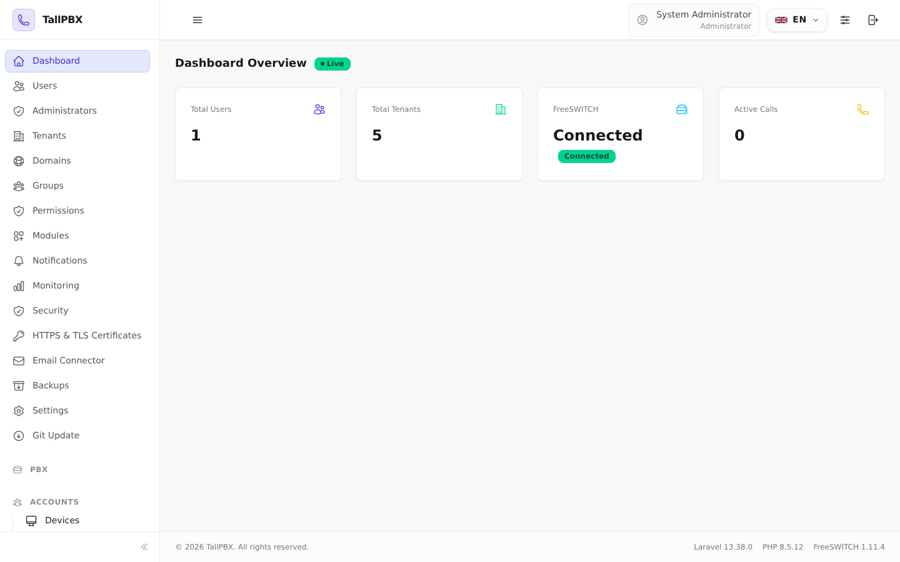

# TallPBX

TallPBX is an open-source business phone system you run on your own Debian server.
Use the web panel to connect phones, set up extensions, route calls, and manage
voicemail and recordings. FreeSWITCH is the phone engine that handles the calls.

## Start Here

- [Install TallPBX](INSTALL.md) on a new server.
- [Connect a phone and make your first call](docs/pbx-hello-world.md) after installation.
- [Compare tested call capacity](docs/load-testing-results.md) when choosing hardware.

## What You Can Do With It

- Connect desk phones and calling apps, and assign an extension to each user.
- Route incoming calls to a person, a group of phones, a menu, a queue, a conference, or voicemail.
- Manage voicemail, call recordings, announcements, music on hold, and fax.
- Send voicemail notifications, password resets, and system alerts by email.
- Manage several businesses or customers on one server, each with its own phone accounts and routing.
- Manage backups, firewall rules, and sign-in protection from the web panel.

To make and receive calls on the public telephone network, connect TallPBX to a
phone service provider through a SIP trunk. The provider supplies the connection
between TallPBX and the public network.

[Compare features with FusionPBX and FreePBX](docs/parity-comparison.md) ·
[Learn the basics of a business phone system](docs/pbx-concepts.md)

## System Requirements

| What you need | Minimum for installation |
| --- | --- |
| Operating system | 64-bit Debian 13 |
| CPU | 1 core, 2 or more recommended |
| Memory | 1 GB RAM and 2 GB swap |
| Disk | 25 GB. Plan for 40 GB or more if you keep voicemail and recordings. |
| Access | An internet connection and administrator access to the server (`root` or `sudo`) |

These are installation requirements. Use the [benchmark results](docs/load-testing-results.md)
to see how the tested servers handled different call loads.

## Quick Start

1. Follow the [Installation Guide](INSTALL.md) to set up the server and run the installer.
2. Open the TallPBX web panel and sign in with your administrator account.
3. Use the [First Call Guide](docs/pbx-hello-world.md) to create an extension,
   connect a phone, and dial `*9196`. You should hear your own voice echoed back.

## User Interface

The web panel supports light and dark themes, three navigation layouts, and
English, Spanish, and French. [Take the web panel tour](docs/ui-tour.md).

## Performance & Load Testing

When a phone connects or someone places a call, FreeSWITCH asks TallPBX for account
details and routing rules. TallPBX returns those answers as XML and keeps
frequently requested answers in Redis, an in-memory cache.

**PHP-FPM** runs TallPBX's fast XML handler by default. The handler loads only
the modules needed to answer phone system requests and skips the web panel setup.
If it catches an application error, the same PHP-FPM process handles the request
through the same entry point as the web panel, loading the full TallPBX application.

[**Laravel Octane**](https://laravel.com/docs/octane) is an optional performance mode. It loads the same telephony
module list as the PHP-FPM fast XML handler and keeps the application loaded in
memory between requests. This reduces startup work for each lookup and can improve
call setup when XML processing is the bottleneck. FreeSWITCH uses the default
PHP-FPM handler when Octane is unavailable. [Enable, verify, or disable Octane](docs/operations.md#octane-xml-worker-optional-performance-mode).

- See [benchmark results and hardware sizing](docs/load-testing-results.md) for
  how many calls the test servers completed and under what conditions.
- [Load Testing Guide](docs/load-testing-guide.md) explains how to measure routing
  lookups and run end-to-end call tests on your own server.

## Tenant Isolation & Phone Provisioning

A **tenant** is a separate phone system workspace for a business or customer.
Use the default tenant for a single business. When several businesses share a
server, give each tenant a separate domain or use a prefix on phone login names
to tell accounts apart on a shared domain.

[Set up tenants](docs/multi-tenancy.md) ·
[Configure desk phones or calling apps](docs/provisioning-guide.md)

## Security & Operations

Use the web panel's **Security Center** to manage firewall rules and automated
blocking of repeated sign-in failures. The Operations guide covers day-to-day
administration, updates, and troubleshooting. [Operations & Maintenance](docs/operations.md) ·
[Backup & Restore](docs/backup-restore-guide.md) ·
[Security architecture](docs/architecture.md#part-ii-security-architecture--linux-kernel-packet-filtering)

## For Developers

TallPBX takes its name from Tailwind CSS, Alpine.js, Livewire, and Laravel.
Laravel is the PHP framework that runs the web application. Built-in features
such as extensions and voicemail are organized in `app-modules/`. Developers can
add integrations through `custom-modules/` or as Composer packages.

- [Developer Guide](docs/developer-guide.md) covers local setup, modules, and tests.
- [System Architecture](docs/architecture.md) explains how the phone engine,
  web application, and security controls work together.
- [Release Checklist](docs/release-checklist.md) covers verification and publishing.

### Running Tests

After following the developer setup, run `tpbx app:test --smoke` for a quick check
or `tpbx app:test` for the feature suite. [Development and test setup](docs/developer-guide.md#1-reproducible-setup).

## Versioning & Release Strategy

TallPBX follows [Laravel's release-series model](https://laravel.com/docs/releases#versioning-scheme)
and [Semantic Versioning](https://semver.org/spec/v2.0.0.html). The active release
series is `5.x`. The web updater supports updates within that series. Moving from
an earlier major release requires a fresh installation.
[Release notes](RELEASE-NOTES.md) · [Changelog](CHANGELOG.md)

## License

TallPBX is released under the [Apache 2.0 license](LICENSE). Contributions and
commercial use are welcome.
