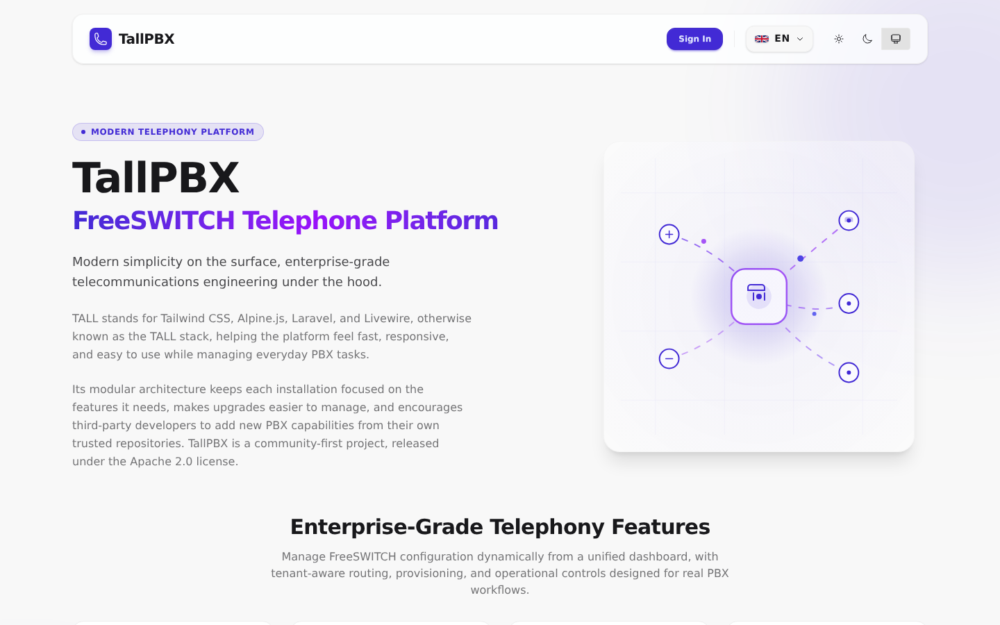
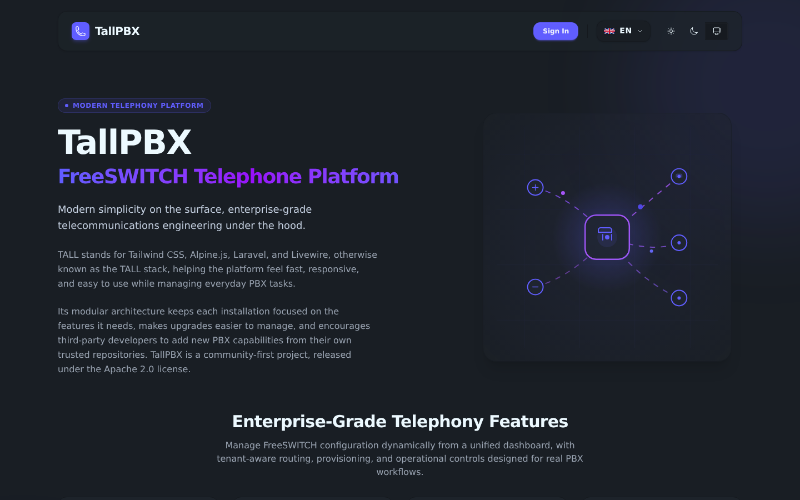
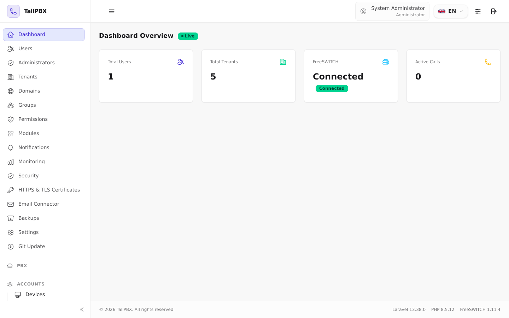
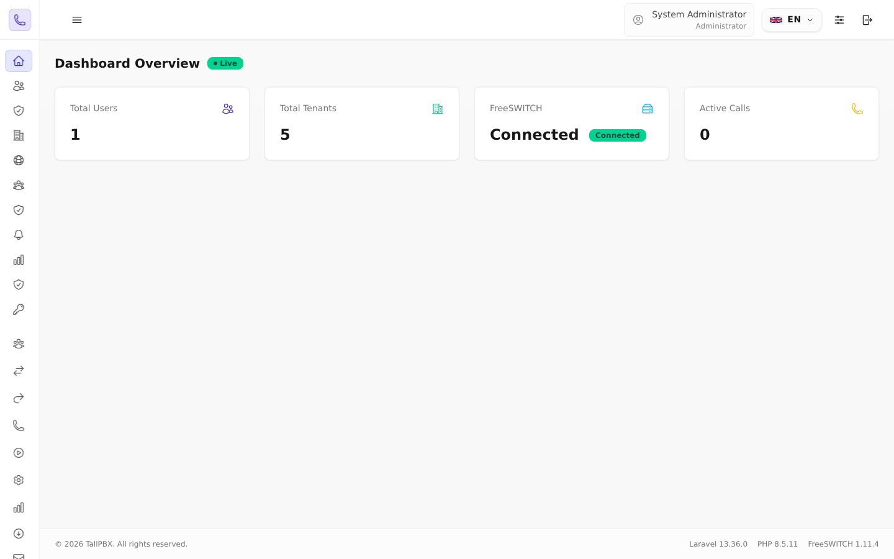
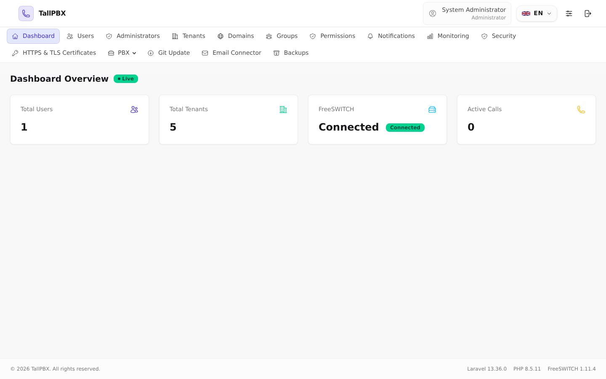

# TallPBX

TallPBX is a self-hosted business phone system named after its foundation on the **TALL stack** (**T**ailwind CSS, **A**lpine.js, **L**ivewire, and **L**aravel). It gives an administrator a web control panel for setting up and managing phones, extensions, call routing, voicemail, recordings, and other everyday PBX features. It runs on your own Debian server and uses FreeSWITCH® to handle calls.

## What You Can Do With It

- Create extensions and connect desk phones or softphones.
- Route incoming calls to people, ring groups, menus, queues, voicemail, or
  conferences.
- Configure outbound calling through a SIP trunk or gateway.
- Manage voicemail, call recordings, music on hold, announcements, and fax.
- Deliver voicemail notifications, password resets, and system alerts via standard username/password SMTP authentication or OAuth 2.0 (Google, Microsoft 365, or custom providers).
- Operate one or more customer or business tenants from the same system.
- Keep backups and restore approved backup operations.
- Defend the PBX with a native Linux kernel firewall (`nftables`), real-time intrusion prevention across SIP, Web, and SSH vectors, automatic ban management, and zero-lockout protection ([System Architecture & Packet Flow Guide →](docs/architecture.md#part-ii-security-architecture--linux-kernel-packet-filtering)).

TallPBX is the phone-system software, not a telephone carrier. You need a SIP
trunk or gateway from a provider if you want to place or receive public phone
network calls.

## Community First

TallPBX is a community-first project, released under the [Apache 2.0 license](https://opensource.org/licenses/Apache-2.0). Encouraging third-party development is the primary goal — integrations, modules, and contributions from the community are always welcome. Commercial use is also welcome.

## Parity with FusionPBX & FreePBX®

Built to eliminate the steep learning curve and dated interfaces of legacy PBX platforms without compromising the raw carrier power of FreeSWITCH®, TallPBX delivers feature and function parity with established open-source systems on a modern Laravel 13, Livewire 4, and Tailwind CSS architecture:

| Feature | TallPBX | FusionPBX | FreePBX® |
| :--- | :--- | :--- | :--- |
| **Telephony Engine** | **FreeSWITCH 1.11** (`mod_sofia`, `mod_callcenter`) | **FreeSWITCH 1.11** | Asterisk 20+ (PJSIP, chan_sip) |
| **Web Architecture** | **Laravel 13, Livewire 4, Tailwind v4** | Custom procedural/OOP PHP | BMO (custom procedural PHP) |
| **Database** | **MariaDB / MySQL** (SQLite in testing) | PostgreSQL / SQLite / MariaDB | MariaDB / MySQL |
| **Configuration** | **Dynamic `mod_xml_curl`** (zero static XML on disk) | Dynamic `mod_xml_curl` (PHP scripts) | Static `.conf` files on disk |
| **Multi-Tenancy** | **Native Multi-Tenant** (isolated contexts or domains) | Native Multi-Tenant (domain only) | Single-Tenant Core |
| **User Impersonation** | **1-Click Native Impersonation** (audit trail & banner) | Limited (domain switching only) | None |
| **Multi-Lingual** | **Native English, Spanish, French** (instant switcher) | Partial / community arrays | Partial gettext / PO files |
| **Firewall & Defense** | **In-Kernel `nftables` + Real-Time Threat Defense** | Fail2ban / iptables scripts | Basic iptables / Fail2ban |
| **Host Security** | **Hardened Bounded Sudoers** (zero web shells or raw SQL) | Web shell (`app/exec`) & raw SQL | Sudoers entries for Asterisk/Apache |
| **Automated Tests** | **2,900+ Pest tests incl. Pest Browser tests** | Minimal / community scripts | Minimal unit tests |
| **Licensing** | **Apache 2.0** (100% open source) | MPL 1.1 (Open source) | GPLv3 (Core) + Commercial closed modules |

See the [Feature and Function Parity Guide](docs/parity-comparison.md) for a domain-by-domain breakdown across all 60 PBX modules, the [PBX Concepts & Fundamentals Guide](docs/pbx-concepts.md) for the Users/Extensions/SIP Accounts/Devices model, and the [System Architecture Guide](docs/architecture.md) for technical modular and security details.

## User Interface & Switchable Themes

TallPBX is built on the **TALL stack** (Tailwind CSS v4, Alpine.js, Livewire 4, Laravel 13) with DaisyUI components, offering a modern responsive control panel with light, dark, and system themes, three switchable navigation layouts, and mobile-friendly responsive drawers:

| Public Landing (Light Theme) | Public Landing (Dark Theme) |
| :---: | :---: |
| [](docs/ui-tour.md#1-public-guest-landing-page) | [](docs/ui-tour.md#1-public-guest-landing-page) |

### Unified Panel & Flexible Navigation Layouts

The single unified panel (`/panel/`) adapts to administrator preference with instant theme and layout toggles:
- **Switchable Themes (Light, Dark, System)**: Instant toggle saved per-user with zero-flicker loading.
- **Collapsible Sidebar (Mini Rail)**: Collapse navigation down to a compact 64px icon rail to maximize screen space for wide PBX data tables (CDRs, call routing, extensions).
- **Horizontal Topbar**: Optional top dropdown layout for administrators accustomed to classic PBX interfaces.
- **Mobile Responsive Drawer**: Compact slide-over menu on mobile screens and tablets.
- **Scroll Preservation**: Keeps your exact scroll position across page transitions.

| Full Sidebar (`w-64`) | Mini Icon Rail (`w-16`) | Horizontal Topbar |
| :---: | :---: | :---: |
| [](docs/ui-tour.md#mode-a-full-sidebar-navigation-w-64) | [](docs/ui-tour.md#mode-b-mini-icon-rail-sidebar-w-16) | [](docs/ui-tour.md#mode-c-horizontal-topbar-navigation) |

👉 **[Explore the Complete Visual Tour (Tenants, Extensions, Devices, Impersonation, Multi-Language & Layouts) →](docs/ui-tour.md)**

## System Requirements

- **Operating System**: Debian 13 server (64-bit)
- **Access**: Root / sudo access with internet connectivity
- **Hardware Tiers**:
  - **Production (Minimum)**: 1 vCPU (2+ recommended), 1 GB RAM, 2 GB swap, 25 GB disk (40 GB+ for recordings/voicemail).
  - **Development / High-Volume**: 4 vCPUs, 4 GB RAM, 2 GB swap, 40 GB disk.

## Quick Start

1. Set up a Debian 13 server matching the requirements above.
2. Follow the [Installation Guide](INSTALL.md) to install TallPBX, FreeSWITCH, Nginx, MariaDB, and Redis with a single command.
3. Open the server's IP address in your browser and log in with your administrator credentials.
4. Follow the [PBX "Hello World" Guide](docs/pbx-hello-world.md) to create your first extension, register a phone (MicroSIP, Linphone, or desk phone), and place a test echo call (`*9196`).
5. Consult the [Operations Guide](docs/operations.md) for production settings, including sound prompt languages, email notifications, capacity tuning, and backups.

The installer is safe to re-run at any time without touching your existing data. [Full installation guide →](INSTALL.md)

## Modular Architecture (Domain-Driven Modular Monolith)

TallPBX is built as a **Domain-Driven Modular Monolith** — an architectural term that simply means:

> **All features are organized into dedicated, self-contained building blocks (domains) inside one unified, reliable application (monolith).**

### What This Means in Plain English
- **Organized by Business Feature, Not Technical Type**: In traditional apps, code is scattered across generic folders (all models together, all controllers together). In TallPBX, each distinct telephony feature (like Extensions, Voicemail, Gateways, or Security) keeps everything it needs — database tables, business rules, web screens, and translations — packaged together in its own self-contained module folder (`app-modules/`).
- **One Unified System (Monolith)**: Everything runs together as a single, rock-solid application. You don't have to manage dozens of separate microservices, network connections between containers, or fragile external packages. When you update TallPBX, the entire system updates together cleanly and reliably.
- **Easy to Turn Features On or Off**: If your organization does not need certain telephony features (like Call Center Queues or Ring Groups), administrators can toggle them off with one click in the panel without touching server files or risking system stability.
- **Clean Foundation for Custom Extensions**: Community plugins and third-party integrations plug in smoothly without altering core application files.

### Key Highlights
- **Built-in Core Modules (`app-modules/`)**: All 60 built-in telephony and administration domains reside in `app-modules/<domain-name>/`. They autoload directly via standard PHP autoloading, update atomically via Git, and are protected against accidental file deletion.
- **Third-Party Extensions (`custom-modules/`)**: Community add-ons and integrations live in the untracked, git-ignored `custom-modules/<name>/` directory, allowing you to add custom features that never interfere with core system updates.
- **Pre-Flight Collision Guards**: External modules are automatically verified so they cannot conflict with core routes, database tables, module names, or permissions.
- **Detailed Technical Specification**: For developers and system architects interested in bounded contexts and service provider internals, see the [System Architecture & Developer Guide →](docs/architecture.md).

Scaffold a new custom third-party extension in `custom-modules/`:

```bash
php artisan make:module my-crm-connector \
    --display-name="My CRM Connector" \
    --description="Third-party CRM integration for customer lookups" \
    --category="Integrations"
```

Manage modules from the command line:

```bash
php artisan module:list            # List installed modules and their status
php artisan module:sync            # Sync module manifests into the database registry
php artisan module:cache           # Build the module manifest cache for fast loading
```

## Telephony Integration (mod_xml_curl)

Instead of generating static XML files on disk, TallPBX serves dynamic configurations to FreeSWITCH on demand over HTTP using `mod_xml_curl`:

- **Dynamic Configuration Delivery**: Extension directories, dialplans, and configurations are generated via the XML Handler API (`/api/v1/xml-handler`).
- **Real-Time Telephony Events**: Call states, connections, and security alerts stream in real time via FreeSWITCH's Event Socket Layer (`php artisan freeswitch:listen`).
- **Redis XML Caching**: Routing lookups are cached in Redis (`FS_XML_HANDLER_CACHE_TTL=5`), protecting the database and ensuring sub-millisecond call setup under heavy load. Web panel changes invalidate active caches immediately.
- **Audio & Media Storage**: Call recordings, voicemails, and greetings are stored on disk under `/var/lib/tallpbx/media/` while metadata remains in the database.

### Tenant Isolation & Phone Provisioning

Configuring a desk phone or softphone adapts to your deployment model:

| Deployment Mode | Server Address on Phone | Extension on Phone | Login (Auth Username) | How Separation Works |
| :--- | :--- | :--- | :--- | :--- |
| **1. Single Company (Default Tenant)** | `x.x.x.x` (or domain) | `101` | `101` | **No separation needed.** All phones register in the Default tenant with clean internal extensions. |
| **2. Multi-Tenant by Domain** | `acme.yourpbx.com` | `101` | `101` | **Separated by Domain.** Each tenant has its own subdomain, allowing duplicate extension numbers across companies. |
| **3. Multi-Tenant on Shared IP** | `x.x.x.x` (shared IP) | `101` | `acme_101` | **Separated by Username.** A tenant prefix on the login ID ensures unique authentication while the phone displays `101`. |

Once registered, FreeSWITCH isolates all call flows, transfers, and voicemails within each tenant's private dialplan context (`tenant_{id}_internal`).

## Integrated Security & Threat Defense

TallPBX includes a first-party Security module (`app-modules/security`) providing defense across telephony, web, and network layers:

- **Linux Kernel Firewall (`nftables`)**: High-performance in-kernel sets (`@whitelist_ips`, `@blacklist_ips`, `@banned_ips`, `@external_blocklist_ips`, `@geo_blocked_ips`, `@geo_blocked_ips6`, `@geo_allowed_ips`, `@geo_allowed_ips6`) with preflight validation (`nft -c -f`) ensuring broken rules are never applied.
- **Dedicated Geo-Blocking (IPdeny Aggregated Zones)**: Pure-drop kernel perimeter (`geo_perimeter`) covering all 249 ISO 3166-1 alpha-2 countries and territories with IPv4 and IPv6 support, dual *Block Selected Countries* and *Block All Except Selected* modes, fail-closed allow-set protection, and automated weekly synchronization.
- **Real-Time Intrusion Defense**: Scans FreeSWITCH SIP authentication failures in real time via the Event Socket Layer (ESL), intercepts web login and SSH brute-force attempts, and enforces temporary rate-based bans in Redis.
- **Zero-Lockout Safety Guard**: Prevents administrators from locking themselves out by verifying remote IP, active sessions, and local loopback services (database and Redis connections) before restrictive policies apply.
- **Hardened System Architecture**: Web processes run under the restricted web user (`www-data`). Privileged firewall operations run through a dedicated root helper (`/usr/local/sbin/tallpbx-security`) with strict input validation.

Manage security from the web panel's **Security Center** or directly from the terminal:

```bash
php artisan security:status              # Check firewall status, active sets, and banned IPs
php artisan security:apply               # Atomically recompile and apply pending firewall rules
php artisan security:unban <IP_ADDRESS>  # Immediately unban an IP address
php artisan security:sync-geoip          # Synchronize IPdeny country zones for Geo-Blocking
php artisan security:sync-threat-feeds   # Synchronize external VoIP fraud threat feeds
```

For packet flow diagrams and architecture details, see [docs/architecture.md](docs/architecture.md#part-ii-security-architecture--linux-kernel-packet-filtering).

## Running the Application

```bash
# Serve the Laravel app (development)
php artisan serve

# Compile frontend assets (in a new terminal)
npm run dev
```

In production, Nginx serves the application automatically. After making code changes, clear application caches:

```bash
php artisan optimize:clear
```

## Running Tests

Tests use Pest with a tiered runner for speed:

```bash
# Smoke — critical-path verification (~20s)
php artisan app:test --smoke

# Default — all feature tests, parallel by default (~65s)
php artisan app:test

# Full — features + Pest 4 browser tests via Playwright
php artisan app:test --full

# Filter a specific test file or class
php artisan test --filter=AdminAuthTest
```

All automated tests execute inside an isolated in-memory SQLite database and temporary cache, **never touching your live MariaDB database** or active calls.

## Performance & Load Testing

TallPBX is built to handle busy phone systems smoothly. When phones register or place calls, FreeSWITCH asks TallPBX for user account and routing rules. TallPBX keeps frequently used rules in high-speed memory (Redis), allowing calls to connect almost instantly (sub-millisecond lookups) without straining the database even during heavy call bursts.

- **Built-in Benchmarking**: Test tooling (`php artisan pbx:load-test:dialplan`) measures call routing speed and capacity.
- **End-to-End SIP Validation**: The test harness (`scripts/pbx-sipp-validate.sh`) verifies phone registrations, outbound calls, audio echo, call forwarding, ring groups, and voicemail.
- **Hardware Capacity**: Tested to sustain 25+ calls/sec and 250+ concurrent channels on standard 4 GB instances.

For complete benchmarking instructions, PHP-FPM pool sizing, and empirical performance metrics across hardware tiers:
- 👉 **[Load Testing Guide (docs/load-testing-guide.md)](docs/load-testing-guide.md)** — Operational runbook for running dialplan and SIPp tests.
- 👉 **[Benchmark Results & Hardware Sizing (docs/load-testing-results.md)](docs/load-testing-results.md)** — Empirical measurements, latency percentiles, and production hardware recommendations.

## Versioning & Release Strategy

TallPBX follows the **[Laravel framework versioning model](https://laravel.com/docs/releases#versioning-scheme)** and adheres to **[Semantic Versioning](https://semver.org/spec/v2.0.0.html)** (`MAJOR.MINOR.PATCH`):

- **Versioned Series Branches**: Following the pattern used by Laravel, the repository does not maintain a perpetual `main` or `master` branch. Instead, active development takes place directly on versioned series branches representing release lines (e.g. `1.1`, `2.0`, `3.x`, `4.x`).
- **Release Strategy**:
  - **Major Releases (`MAJOR.0.0`)**: Represent significant architectural milestones or breaking changes. For example, the `4.x` series modernizes the entire codebase into a clean modular architecture and requires a fresh install rather than an in-place upgrade from earlier major lines (`3.x`, `2.0`, `1.x`).
  - **Minor Releases (`MAJOR.MINOR.0`)**: Introduce new features, modules, and backwards-compatible enhancements within a release series.
  - **Patch Releases (`MAJOR.MINOR.PATCH`)**: Deliver targeted bug fixes, security patches, and performance improvements.
- **Active Release Branches**:
  - **`4.x`**: Current primary development branch for 4.x features and releases.
  - **`3.x`**: Maintenance release series for 3.x deployments.
  - **`2.0`**: Maintenance release series for 2.x deployments.
  - **`1.1`**: Maintenance release series for 1.1.x deployments.
  - **`1.0`**: Frozen maintenance branch for critical security fixes only.
- **In-Place Updates**: In-place updates via the web updater panel (**System Settings → Updates**) and CLI (`scripts/update.sh`) are supported within the same release series branch. For detailed deployment notes, see [INSTALL.md](INSTALL.md), and for a complete historical record of releases, see [CHANGELOG.md](CHANGELOG.md).

## Tech Stack

| Component | Version |
|---|---|
| Laravel | 13 |
| Livewire | 4 |
| Tailwind CSS | 4 |
| DaisyUI | latest |
| Alpine.js | 3 (via Livewire) |
| Laravel Boost | 2 (dev) |
| Pest | 4 |

## License

Open-sourced under the [Apache 2.0 license](https://opensource.org/licenses/Apache-2.0).
