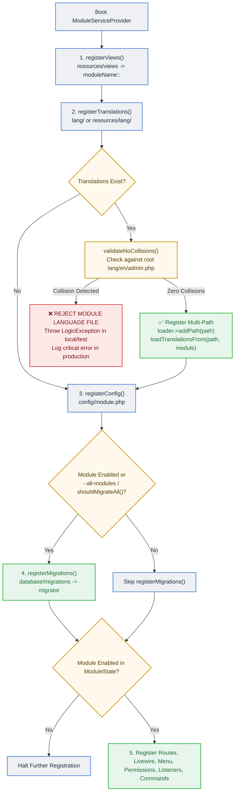
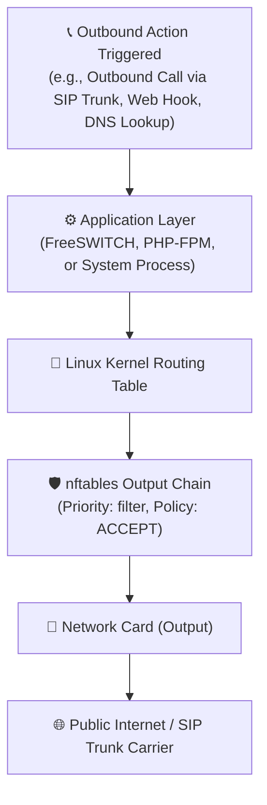
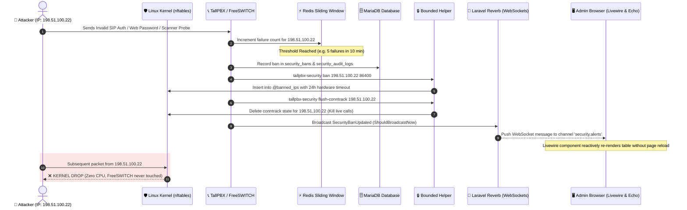
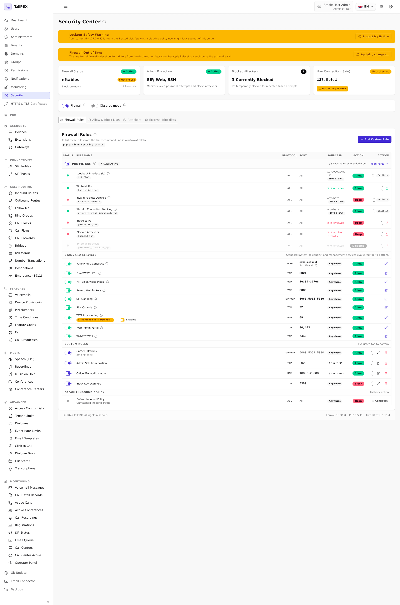
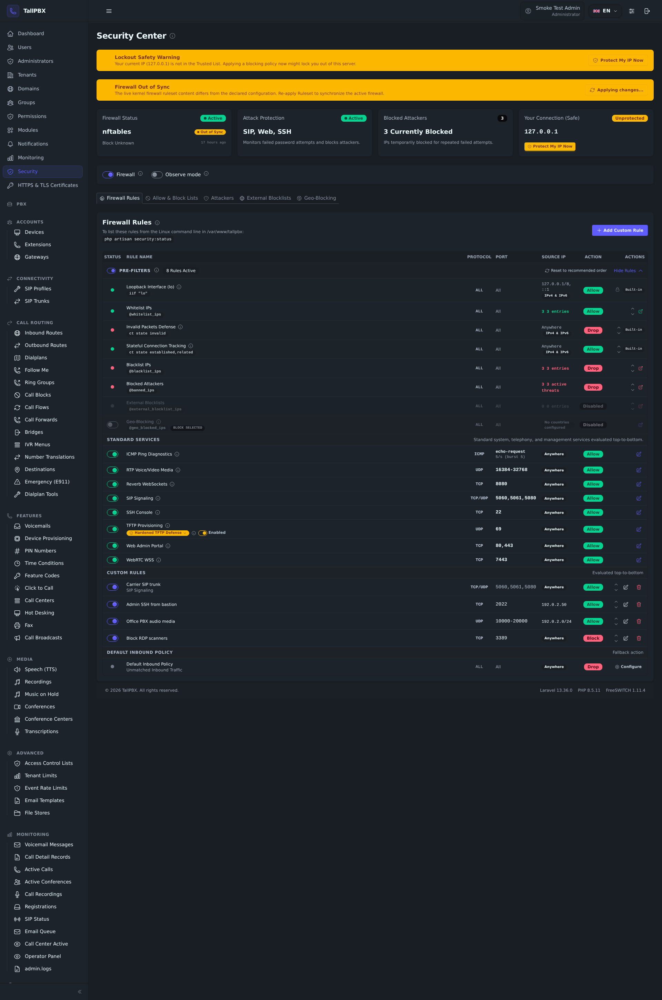

# TallPBX System Architecture & Developer Guide

This document is the authoritative technical reference for the architecture of TallPBX: its **Domain-Driven Modular Monolith** application structure (`app-modules/`), service provider lifecycle, modular translation system, telephony engine integration, and Linux kernel security architecture (`nftables`). It provides developers, sysadmins, and system architects with complete architectural specifications, runtime lifecycles, and packet flow details.

---

## 1. Domain-Driven Modular Monolith Architecture

TallPBX 4.x organizes its telecommunications, administrative, and PBX capabilities as a **Domain-Driven Modular Monolith**.

### What This Means in Plain English

Before diving into technical implementation details, here is what this architecture means in practical terms:
- **Domain-Driven (Organized by Real-World Feature)**: A "domain" is a distinct business function. In traditional monolithic web applications, code is split by technical type (e.g. all database models in one giant folder, all web controllers in another, all views in a third). In a domain-driven system, code is organized around real-world telephony concepts: everything related to Extensions lives together in `app-modules/extensions/`, everything related to Voicemail lives in `app-modules/voicemail/`, and everything related to Security lives in `app-modules/security/`. Each domain encapsulates its own models, migrations, business logic, UI components, and translations.
- **Modular (Self-Contained Building Blocks)**: Each feature is an independent module with clearly defined boundaries. Modules interact with each other through explicit contracts and events rather than messy direct database dependencies. This makes individual features easy to understand, test, maintain, and toggle on or off without unintended side effects.
- **Monolith (Unified, Single Deployable System)**: Unlike microservice architectures that require deploying and orchestrating dozens of separate services, network boundaries, and container fleets, TallPBX remains a single, coherent application. It deploys as one unit, updates atomically via Git, uses a shared database and cache, and runs with high performance and zero network latency between components.

Rather than maintaining all models, controllers, Livewire components, routes, migrations, and translation strings in a single monolithic `app/` directory or treating internal modules as fragile pseudo-packages, each domain feature is encapsulated into a cohesive **bounded context** in `app-modules/`.

### Core Architectural Principles
1. **Single Deployable Monolith**: All built-in modules belong to the unified core codebase and update atomically via Git. They are NOT independent microservices or separate Composer packages.
2. **Direct Root PSR-4 Autoloading**: All built-in modules are mapped directly in root `composer.json` via standard PSR-4 (`Modules\{Domain}\` => `app-modules/{domain}/src/`). Root `composer.json` contains 0 path repositories and 0 `tallpbx/module-*` package requirements.
3. **No Physical Deletion of Core Modules**: Built-in modules in `app-modules/` are permanent parts of the system and are never deleted from disk. Disabling a module is strictly logical (`enabled = false` in the database registry, suppressing route, view, and provider registration).
4. **Clean Extensibility Boundary (`custom-modules/` & `vendor/`)**: Third-party community modules reside in the untracked, git-ignored `custom-modules/{name}/` directory or in standard Composer packages under `vendor/`. External modules are guarded by strict Pre-flight Collision Guards (Route, Database Schema, Module Name, Language Keys, and Permissions).
5. **Standardized Base Service Provider**: All modules boot via a child class extending `App\Support\ModuleServiceProvider`, eliminating repetitive boilerplate for views, migrations, routes, Livewire components, permissions, and translations.
6. **Decoupled Cross-Domain Communication**: High cohesion within domains, low coupling between domains. Modules communicate through Laravel events, service contracts, or published interfaces rather than deep cross-domain database coupling.
7. **Zero-Friction Scaffolding**: The Artisan command `php artisan make:module <name>` scaffolds production-ready modules conforming strictly to project conventions.

---

## 2. Directory Layout of a Module

Each module under `app-modules/{module-name}/` follows a standardized layout:

```
app-modules/{module-name}/
├── module.json                 # TallPBX module manifest (schema, display name, category)
├── config/                     # Optional module configuration merged over defaults
│   └── {module-name}.php
├── database/
│   └── migrations/             # Database migrations auto-loaded by provider
├── lang/                       # Modular translation dictionaries (en, es, fr)
│   ├── en/
│   │   ├── admin.php           # Admin panel strings for this module
│   │   └── client.php          # Tenant portal strings (if module has client UI)
│   ├── es/
│   │   └── admin.php
│   └── fr/
│       └── admin.php
├── resources/
│   └── views/                  # Blade views auto-registered under {module-name}:: namespace
│       └── index.blade.php
├── routes/                     # Optional route definition (web.php / api.php)
├── src/
│   ├── Database/
│   │   └── Factories/          # Model factories for testing and seeding
│   ├── Livewire/               # Livewire 4 full-page workbenches and modals
│   ├── Models/                 # Eloquent models
│   ├── Providers/
│   │   └── ModuleServiceProvider.php # Module registration provider
│   └── Services/               # Domain business logic and FreeSWITCH interfaces
└── tests/                      # Automated Pest unit and feature tests
```

---

## 3. ModuleServiceProvider Lifecycle

All module service providers extend `App\Support\ModuleServiceProvider` (which extends `Illuminate\Support\ServiceProvider`). During application booting, the base provider executes a structured sequence:



### 3.1 Migration Gating and `--all-modules` Flag

By default, disabled modules do not register their database migrations. This ensures standard maintenance commands like `php artisan migrate` only mutate the database schema for active, enabled modules and the shared kernel.

When an administrator or automated deployment script needs to retain or run database migrations across all installed modules regardless of enablement state, pass the global `--all-modules` flag:
```bash
php artisan migrate --all-modules
```
Programmatic tests and maintenance jobs can control this behavior using `ModuleState::setForceAllModulesMigrations(true)`.

---

## 4. Modular Translation Architecture (Unified Language Files)

TallPBX allows each module to keep its own translation files while automatically merging them into the main application dictionaries (`admin` and `client`). This keeps module text organized inside each module folder without requiring changes to existing views, buttons, or translation calls.

### 4.1 How It Works & Why It Matters
- **Clean Standard Calls**: Templates continue using standard translation calls like `__('admin.gateway_host')`. Developers do not need to add package prefixes like `__('gateways::admin.gateway_host')`.
- **Consistent UI Buttons**: Common action buttons (`Save`, `Cancel`, `Edit`, `Delete`) remain completely uniform and reliable across English, Spanish, and French.
- **Module Independence**: Module text lives directly inside `app-modules/{module}/lang/{locale}/admin.php`, so translations stay right beside the views and logic that use them.
- **Automatic Fallback & Merging**: When a page requests text, the translation system checks the module folder first and falls back to the main system language files.

### 4.2 Avoiding Overlapping Names (Key Collisions)
Because module translations merge into the shared language dictionary (`admin`), a key in a module file could accidentally overwrite a shared system button if both shared the exact same name.

To keep translations reliable and safe:
1. **Shared System Words Stay in Root (`lang/{locale}/admin.php`)**:
   - Universal action labels (`Save`, `Cancel`, `Delete`, `Edit`, `Filter`, `Actions`, `Enabled`, `Disabled`, `Status`, `Back`) belong exclusively in the main root dictionary.
   - Main navigation menu names (`Gateways`, `Extensions`, `SIP Profiles`) live in root so menus always display correctly even if a module is temporarily stopped.
2. **Module Keys Use Descriptive Names**:
   - Every translation key in a module file must include the feature or entity name (for example: `gateway_host`, `gateway_name_tooltip`, `create_gateway`, `no_gateways_found`).
   - Module files must never define generic words like `save` or `delete`.

### 4.3 Mandatory Module Language File Header Comment
Every module language file (`app-modules/{module}/lang/{en,es,fr}/admin.php`) must begin with the standardized collision warning docblock:

```php
<?php

/**
 * --------------------------------------------------------------------------
 * Module Language Lines: {displayName} ({module_name})
 * --------------------------------------------------------------------------
 *
 * COLLISION PREVENTION & KEY NAMING RULES:
 * Under TallPBX's multi-path cascading translation architecture, module
 * language files merge directly into the global group dictionary (e.g. 'admin')
 * at runtime.
 *
 * To prevent collisions across modules or with the root dictionary:
 * 1. Every key defined in this file MUST include the module/entity name
 *    (e.g. '{entity}_host', 'create_{entity}', 'no_{entities}_found').
 * 2. Generic keys (e.g. 'save', 'cancel', 'delete', 'edit', 'enabled', 'disabled',
 *    'status', 'actions') belong strictly in root lang/{locale}/admin.php and
 *    must NEVER be defined in module language files.
 * 3. Module language files will be rejected at runtime by ModuleServiceProvider
 *    if any collision with root language keys is detected.
 */

return [
    // ...
];
```

### 4.4 Runtime Collision Guard
During module boot, `App\Support\ModuleServiceProvider` validates that module language files do not collide with root keys:
- The provider parses keys from the module's `lang/en/{group}.php`.
- It computes the intersection with the root `lang/en/{group}.php` keys.
- **Fail-Fast Enforcement**:
  - In `local` and `testing` environments: throws a `LogicException`:
    ```
    Module [gateways] language file [admin] collides with root dictionary for key(s): [save, delete]. Refusing to load.
    ```
  - In `production`: logs a critical alert to `Log::critical()` and skips loading the colliding module file, protecting the integrity of the root dictionary.

### 4.5 Automated Architecture Test Suite (`TranslationParityTest`)
The test suite at `tests/Feature/Architecture/TranslationParityTest.php` runs on every CI run and local test cycle:
- **Zero Root Collisions**: Asserts that no module language file defines any key that exists in root `lang/{locale}/admin.php`.
- **Zero Cross-Module Collisions**: Asserts that no two modules define the same translation key.
- **Entity Domain Relevance**: Asserts that keys defined in a module include the module or entity domain identifier.
- **100% Locale Parity**: Asserts that every key defined in `en` exists with identical keys in `es` (Spanish) and `fr` (French).

---

## 5. Scaffolding Custom Modules with Artisan (`make:module`)

In the Domain-Driven Modular Monolith, built-in modules (`app-modules/`) are part of the permanent appliance monorepo maintained directly in version control. To keep the developer experience clean and avoid fragile runtime mutations of root `composer.json`, the scaffolding command `php artisan make:module` is dedicated exclusively to generating **third-party community modules** in `custom-modules/`:

```bash
php artisan make:module my-crm-connector \
    --display-name="My CRM Connector" \
    --description="Third-party CRM integration for customer lookups" \
    --category="Integrations"
```

### Key Behaviors:
- **Target Location**: Scaffolds directly into `custom-modules/{name}/` (untracked, git-ignored).
- **Zero Root Mutation**: Leaves root `composer.json` completely untouched.
- **Manifest (`module.json`)**: Generates the standard manifest tagged with `source: "custom"`, setting up namespace (`CustomModules\{Studly}`), display name, category, and dependencies.
- **Service Provider**: Generates `src/Providers/ModuleServiceProvider.php` extending `App\Support\ModuleServiceProvider` with `moduleNamespace()` returning `CustomModules\{Studly}`.
- **Instant Dynamic Autoloading**: Automatically discovered and autoloaded at runtime via `CustomModuleAutoloader` (`CustomModules\` namespace) without running `composer dump-autoload`.
- **Component Stubs**: Pre-generates boilerplate Livewire component directories, model factories, Blade views, migration directories, and collision-safe translation files (`lang/{en,es,fr}/admin.php`).
- **Core Collision Protection**: Rejects names that collide with existing core modules in `app-modules/` (e.g. `php artisan make:module extensions` will fail with an error).

### 5.1 Distributing Custom Modules as Composer Packages (`vendor/`)

While developing locally in `custom-modules/` provides instant zero-build feedback, custom modules can also be packaged and installed as **Composer packages in `vendor/`** (`source: "vendor"`). This allows teams and community authors to distribute custom modules via private Git repositories, Packagist, or Satis.

#### Step-by-Step Workflow:

1. **Scaffold the Module Locally**:
   Start by generating the module skeleton in `custom-modules/`:
   ```bash
   php artisan make:module my-crm-connector \
       --display-name="My CRM Connector" \
       --category="custom"
   ```

2. **Publish to an External Git Repository**:
   Initialize a dedicated Git repository (e.g. on GitHub or GitLab) and copy the generated files from `custom-modules/my-crm-connector/` into the new repository.

3. **Add a Root `composer.json` to Your Module Repository**:
   In the root of your standalone module repository, create a standard `composer.json` defining the package name and PSR-4 autoloading:
   ```json
   {
       "name": "acme/tallpbx-crm-connector",
       "description": "Third-party CRM connector for TallPBX",
       "type": "library",
       "license": "proprietary",
       "autoload": {
           "psr-4": {
               "CustomModules\\MyCrmConnector\\": "src/"
           }
       },
       "extra": {
           "tallpbx": {
               "module": true
           }
       }
   }
   ```
   *(Note: Set the `"source": "vendor"` field in your module's `module.json` to reflect that it is installed as a Composer package).*

4. **Install via Composer in TallPBX**:
   Remove the local development folder `custom-modules/my-crm-connector/` to prevent name collision guards from blocking the vendor package. Then add your Git repository and require the package in TallPBX's root `composer.json`:
   ```bash
   # Add private repository (if hosted privately on GitHub)
   composer config repositories.crm-connector vcs https://github.com/your-org/tallpbx-crm-connector.git

   # Install the package
   composer require acme/tallpbx-crm-connector
   ```

5. **Discovery & Activation**:
   TallPBX's discovery scanner inspects `vendor/*/*/module.json` on boot and caches the discovered manifest (`bootstrap/cache/modules.php`). Synchronize and activate the module:
   ```bash
   php artisan module:sync
   ```
   The module will appear in `/panel/modules` under the **Custom** category with a `"Vendor"` source tag, and can be enabled, disabled, or uninstalled (`module:uninstall`) directly from the panel or CLI.

---

## 6. Translation Authoring Guidelines

When creating translation keys for a module:
1. **Module Domain Prefixing**: Every key defined in `app-modules/{module}/lang/{en,es,fr}/admin.php` must include the entity or domain name (e.g. `gateway_*`, `create_gateway`, `modal_delete_gateway_title`).
2. **Root Action Keys**: Generic action labels (`save`, `delete`, `edit`, `cancel`, `enabled`, `disabled`, `status`, `actions`) belong strictly in root `lang/{locale}/admin.php` and must never be defined in module dictionaries.
3. **Locale Parity**: All module keys must be populated across all supported languages (`en`, `es`, `fr`).
4. **Header Docblock**: All module translation files must begin with the collision prevention docblock.
5. **Verification**: Verify that keys follow all collision and parity rules:
   ```bash
   php artisan optimize:clear
   ./vendor/bin/pest tests/Feature/Architecture/TranslationParityTest.php
   ```

---

## 7. Multi-Source Discovery, Boot Guards & Custom Module Lifecycle

### 7.1 Why Path Repositories Were Replaced With Direct PSR-4

TallPBX 3.x registered each of its 60 built-in modules as a Composer **path repository** with a
`tallpbx/module-*` require entry. That design had three compounding costs:

1. **Composer execution time**: every `composer` invocation resolved and symlinked 60 path
   packages, pushing autoloader generation from under 2 seconds to over a minute on modest
   hardware.
2. **Fragile boot coupling**: modules registered their providers through
   `extra.laravel.providers` inside per-module `composer.json` files; deleting a module directory
   without a perfect Composer dance left the installation un-bootable.
3. **Module blur**: first-party code was packaged as if it were third-party, so the Git
   updater and module lifecycle constantly negotiated with Composer state.

TallPBX 4.x replaces all of it with **direct root PSR-4 autoloading**
(`Modules\{Domain}\` => `app-modules/{domain}/src/`) plus a manifest-driven discovery engine
(`App\Providers\ModuleServiceProvider`). Root `composer.json` carries zero path repositories and
zero `tallpbx/module-*` requirements, and the vestigial per-module `composer.json` files are gone.

### 7.2 Multi-Source Discovery

Discovery scans three locations and tags every module with a `source`:

| Source | Location | Autoloading |
| :--- | :--- | :--- |
| `core` | `app-modules/*/module.json` | Root PSR-4 |
| `custom` | `custom-modules/*/module.json` | Runtime `CustomModuleAutoloader` (`CustomModules\{Name}\`) |
| `vendor` | `vendor/*/*/module.json` | Composer classmap |

Parsed manifests are cached to `bootstrap/cache/modules.php` (regenerated by `module:sync`,
`module:cache`, `make:module`, and `optimize:clear`). Both the cold scan and the cached path run
the same boot guards, so behavior never depends on cache state.

### 7.3 Pre-Flight & Runtime Collision Guards (`App\Services\ModuleCollisionGuard`)

Third-party modules are untrusted code. Before and during registration the appliance enforces:

| Guard | Rule | Enforcement point |
| :--- | :--- | :--- |
| Module name | A custom module may not shadow an installed module's name — rejected with a logged error | Discovery merge + cached-path validation |
| Route boundaries | Custom route files may not bind reserved panel URLs (`/panel/login`, `/panel/setup`, `/panel/dashboard`, `/panel/settings`, `/panel/modules`, `/panel/git-update`) or hijack existing route names; offending files are never loaded | Static pre-flight scan + post-load router audit |
| Database schema | Custom migrations may not create existing tables or touch protected core tables (`users`, `admins`, `tenants`, `groups`, `permissions`, `modules`, `menus`) — the run halts with `MigrationCollisionException` | Static token scan + runtime `beforeExecuting` DDL watch |
| Language keys | Custom translations colliding with another module's dictionary lose their global shortcut and fall back to namespaced `{module}::` lookups | `App\Support\ModuleServiceProvider` inter-module registry |
| Permissions | Custom modules cannot claim permissions already owned by another module | `PermissionService` ownership guard |
| Dependencies | Unmet `requirements.modules` or `requirements.packages` disable the module (manifest + registry + provider skip) with a critical log instead of crashing the appliance — on both boot paths | Discovery fail-soft check |

### 7.4 Custom Module Lifecycle

| Action | Core (`app-modules/`) | Custom (`custom-modules/`) | Vendor (`vendor/`) |
| :--- | :--- | :--- | :--- |
| Disable | `/panel/modules` toggle | `/panel/modules` toggle | `/panel/modules` toggle |
| Uninstall | **Refused** — permanent monorepo code | `module:uninstall` with typed confirmation (`UNINSTALL {name}`); directory and registry record deleted; **irreversible** | `module:uninstall` — removed via Composer |
| Restore | N/A (never uninstalled) | N/A (untracked — nothing to restore from) | `module:restore` — Composer re-require from the recorded package |

`module:sync` prunes ghost core registry rows (a `source = 'core'` row whose directory is gone is
always dead) while preserving custom/vendor rows so unplugged modules keep their state.

Scaffold new modules with `php artisan make:module <name>` — it writes to
`custom-modules/{name}/` only, tags the manifest `source: custom`, and refreshes the manifest
cache. Route auto-registration (Livewire `List`/`Edit` component conventions) and dialplan XML
hooks (`DialplanXmlContributor`) work identically for custom modules and core modules.

### 7.5 Backups: System Superadmin Disaster Recovery

The Backups module is a required Core Administration utility (`required: true` — it cannot be
disabled) that owns its own routes, menu entry, and permissions. Third-party modules ride with
the "Application files" backup scope: `custom-modules/` is captured into every backup that includes
that scope, included in pre-restore rollback snapshots, and restored module-by-module — modules
installed after a backup are left untouched. See the Security Center documentation for
firewall-adjacent restore safety rules.

---

---

# Part II: Security Architecture & Linux Kernel Packet Filtering

## 8. Visual Packet Flow: Inbound Traffic

When an internet packet reaches the server's network interface, it is evaluated by the Linux kernel **before** any application software (like FreeSWITCH or the web server) ever sees it.

TallPBX compiles an optimized, multi-stage Linux kernel firewall ruleset using native `nftables` (`table inet tallpbx_filter`, hook `input`, priority `-10`).

The diagram below illustrates this path from input to processing:

```mermaid
flowchart TD
    %% Styling Classes
    classDef drop fill:#fde8e8,stroke:#e05252,stroke-width:2px,color:#7a1010
    classDef allow fill:#e8f5ec,stroke:#3fb950,stroke-width:2px,color:#1a6b32
    classDef spine fill:#eef0f3,stroke:#5b8fd9,stroke-width:2px,color:#1c2a40
    classDef svc fill:#fef9ec,stroke:#d29922,stroke-width:2px,color:#5a3e08
    classDef prefilter fill:#e8eef8,stroke:#4a77b4,stroke-width:2px,color:#15325b

    %% Root Ingress Trunk (Centered)
    A["🌐 Incoming Network Packet<br/>(Internet / LAN)"]:::spine --> B["🔌 Physical Network Card<br/>(eth0 / ens3 / lo)"]:::spine
    B --> C["🛡️ Linux Kernel Firewall<br/>(nftables inet tallpbx_filter input)"]:::spine

    %% Global Mode Checks
    C --> FW_CHECK{"Firewall Enabled?"}:::spine
    FW_CHECK -->|NO: Disabled| PASS_ALL["✅ ALLOW ALL TRAFFIC<br/>(Only lo & established active)"]:::allow
    FW_CHECK -->|YES: Enabled| OBS_CHECK{"Observe Mode Active?"}:::spine

    OBS_CHECK -->|YES: Observe Mode| OBS_NOTE["👁️ GLOBAL OBSERVE MODE<br/>(Log & count drops, never block)"]:::svc
    OBS_CHECK -->|NO: Enforcing| PREFILTER_CHECK{"Pre-Filter Pipeline Enabled?"}:::spine
    OBS_NOTE --> PREFILTER_CHECK

    %% Subgraph: Reorderable Pre-Filter Pipeline (Stages 1-7)
    subgraph PREFILTER ["Built-in Pre-Filter Pipeline (Stages 1–7: Reorderable)"]
        direction TB
        PREFILTER_CHECK -->|YES: Default Order| D{"Stage 1: Loopback Interface?<br/>(iif 'lo')"}:::prefilter
        D -->|YES: Localhost| PASS_LO["✅ ALLOW UNCONDITIONALLY<br/>(Localhost MariaDB, Redis, IPC)"]:::allow
        D -->|NO: External| S2{"Stage 2: Trusted Whitelist?<br/>(@whitelist_ips / @whitelist_ips6)"}:::prefilter

        S2 -->|YES: Admin / Office| PASS_WL["✅ ALLOW UNCONDITIONALLY<br/>(Bypass Port Checks)"]:::allow
        S2 -->|NO: Untrusted| S3{"Stage 3: Invalid Packet State?<br/>(ct state invalid)"}:::prefilter

        S3 -->|YES: Malformed| DROP_INV["❌ DROP IMMEDIATELY<br/>(Out-of-Window / Bad Flags)"]:::drop
        S3 -->|NO: Valid| S4{"Stage 4: Established or Related?<br/>(ct state established,related)"}:::prefilter

        S4 -->|YES: Active Session| PASS_FAST["✅ ALLOW DIRECTLY<br/>(Fast-path Conntrack Bypass)"]:::allow
        S4 -->|NO: New Connection| S5{"Stage 5: Permanent Blacklist?<br/>(@blacklist_ips / @blacklist_ips6)"}:::prefilter

        S5 -->|YES: Blacklisted| DROP_BL["❌ DROP IMMEDIATELY<br/>(Kernel Interval Tree Discard)"]:::drop
        S5 -->|NO: Safe| S6{"Stage 6: Active Intruder Ban?<br/>(@banned_ips / @banned_ips6)"}:::prefilter

        S6 -->|YES: Banned| DROP_BAN["❌ DROP IMMEDIATELY<br/>(Dynamic Kernel Auto-Timeout)"]:::drop
        S6 -->|NO: Safe| S7{"Stage 7: External Blocklists?<br/>(@external_blocklist_ips / @external_blocklist_ips6)"}:::prefilter

        S7 -->|YES: VoIPBL Hit| DROP_FEED["❌ DROP IMMEDIATELY<br/>(Public Fraud / Scanner Network)"]:::drop
    end

    PREFILTER_CHECK -->|NO: Disabled| S8
    S7 -->|NO: Safe| S8{"Stage 8: Diagnostic Ping?<br/>(ICMP / ICMPv6 echo-request)"}:::spine

    %% Stages 8-12: Core Services & Policies
    S8 -->|Echo > Limit / Stealth| DROP_ICMP["❌ DROP / STEALTH<br/>(Rate Limited or Blocked)"]:::drop
    S8 -->|Echo <= Limit or IPv6 ND/RA| PASS_ICMP["✅ ALLOW REACHABILITY<br/>(Controlled Diagnostics & IPv6)"]:::allow
    S8 -->|Non-ICMP Traffic| S9{"Stage 9: Port UDP 69?<br/>(TFTP Provisioning Defense)"}:::spine

    subgraph TFTP_PROFILE ["Hardened TFTP Defense Profile (Stage 9)"]
        direction TB
        S9 -->|Opcode 2: WRQ Write| DROP_TFTP_WRQ["❌ DROP UPLOAD<br/>(Provisioning is Read-Only)"]:::drop
        S9 -->|Traversal '../' or '/x'| DROP_TFTP_PROBE["❌ DROP SCAN PROBE<br/>(Directory Traversal Filter)"]:::drop
        S9 -->|Rate > Flood Meter| DROP_TFTP_FLOOD["❌ DROP FLOOD<br/>(Bounded Kernel Meter)"]:::drop
        S9 -->|Valid RRQ Read| PASS_TFTP["✅ ALLOW TFTP PROVISIONING<br/>(Legitimate Phone Boot)"]:::allow
    end

    S9 -->|Other Ports| S9_5{"Stage 9.5: Geo-Blocking Rule Active?<br/>(jump geo_perimeter)"}:::spine

    subgraph GEO_PERIMETER ["Dedicated Geo-Blocking Perimeter Chain (Stage 9.5)"]
        direction TB
        S9_5 -->|Mode: Block Selected & Country Match| DROP_GEO_BL["❌ DROP UNWANTED ORIGIN<br/>(@geo_blocked_ips / @geo_blocked_ips6)"]:::drop
        S9_5 -->|Mode: Block Except Selected & Non-Match| DROP_GEO_WL["❌ DROP UNAPPROVED ORIGIN<br/>(!= @geo_allowed_ips / @geo_allowed_ips6)"]:::drop
        S9_5 -->|Country Permitted / Geo Disabled| S10
    end

    S10{"Stage 10 & 11: Core PBX Port or Custom Rule?"}:::spine

    %% Subgraph: Application & Services
    subgraph SERVICES ["PBX Services & Application Routing (Stages 10–12)"]
        direction TB
        S10 -->|SIP 5060/5061/5080| K["📞 FreeSWITCH Telephony"]:::svc
        S10 -->|RTP 16384-32768| L["🔊 Audio Stream (RTP)"]:::svc
        S10 -->|Web 80/443| M["🌐 Nginx & Web Admin"]:::svc
        S10 -->|SSH 22| N["🔒 Secure Shell (SSH)"]:::svc
        S10 -->|No Rule Matched| S12{"Stage 12: Default Inbound Policy?"}:::spine

        S12 -->|Policy = DROP| DROP_DEF["❌ DROP PACKET<br/>(Blocked by Default)"]:::drop
        S12 -->|Policy = ACCEPT / Observe| PASS_DEF["✅ ACCEPT PACKET"]:::allow

        %% Telephony Application Layer
        K --> BOT_CHECK{"FreeSWITCH SIP Scanner Filter<br/>(Public Call Context)"}:::svc
        BOT_CHECK -->|Known Bot: sipvicious, sipcli, etc.| DROP_BOT["🚨 403 HANGUP & AUTO-BAN<br/>(Flush Conntrack Live Sessions)"]:::drop
        BOT_CHECK -->|Valid SIP Peer| SIP_AUTH{"SIP Password & ACL Auth"}:::svc
        SIP_AUTH -->|Failed Auth Streak| DROP_AUTH["🚨 401/403 Failure Streak<br/>(Trigger Dynamic Kernel Ban)"]:::drop
        SIP_AUTH -->|Authorized Extension / Trunk| CALL_OK["📱 Call Connected & Audio Rings"]:::allow

        %% Web Application Layer
        M --> WEB_AUTH{"Web Auth Guard"}:::svc
        WEB_AUTH -->|Failed Password Streak| DROP_WEB["🚨 Trigger Dynamic Kernel Ban"]:::drop
        WEB_AUTH -->|Valid Admin / User| WEB_OK["🖥️ Access Control Panel"]:::allow
    end
```



---

## 9. Inbound Pipeline Stages Detailed

The Linux kernel evaluates rules strictly in order across **13 deterministic stages**:

### 1. Pre-Filter Pipeline (Stages 1–7)
Toggled and reordered as an administrative unit in the **Firewall Rules** tab:
1. **Loopback Interface (`iif "lo" accept`)**: Unconditional access for server processes (PHP-FPM to MariaDB, Redis, and FreeSWITCH ESL).
2. **Trusted Whitelist (`@whitelist_ips accept`)**: Admin IPs, office subnets, and SIP carrier interconnects bypass all lower drop checks.
3. **Invalid Packet State (`ct state invalid drop`)**: Corrupted headers and illegal TCP flag combinations are discarded immediately.
4. **Stateful Fast Path (`ct state established,related accept`)**: Established call audio (RTP) and active sessions pass with zero CPU lookup overhead.
5. **Permanent Blacklist (`@blacklist_ips drop`)**: Explicitly forbidden IPs/CIDRs dropped at line rate via kernel interval trees.
6. **Active Intrusion Bans (`@banned_ips drop`)**: Dynamic hardware-timed bans triggered by authentication failures or scanner probes.
7. **External Blocklists (`@external_blocklist_ips drop`)**: Curated VoIP fraud and scanner networks (e.g. VoIPBL) dropped at the perimeter.

### 2. Diagnostics, Protocol Defense & Perimeter Filtering (Stages 8–9.5)
8. **ICMP Ping Diagnostics**: Rate-limited ping requests (5/sec) plus essential IPv6 neighbor discovery (`nd-neighbor-solicit`, `nd-router-advert`).
9. **Hardened TFTP Defense Profile (UDP 69)**: Protects phone provisioning by dropping upload requests (WRQ opcode 2), directory traversal probes (`../`, `/x`), and flood requests.
9.5. **Dedicated Geo-Blocking Perimeter Chain (`jump geo_perimeter`)**: Pure drop filter evaluated immediately before PBX application ports. Traverses pre-aggregated IPdeny CIDR ranges in either *Block Selected Countries* (`@geo_blocked_ips`, `@geo_blocked_ips6`) or *Block All Except Selected* (`@geo_allowed_ips`, `@geo_allowed_ips6`) mode. Packets from unblocked countries fall through to lower stages; it never issues an unconditional accept.

### 3. Service Catalog & Fallback (Stages 10–12)
10. **Core PBX Port Catalog**: Explicit allow rules for SIP (5060/5061/5080), RTP Audio (16384–32768), Web Admin (80/443), and SSH (22).
11. **Custom Sequential Rules**: User-defined rules evaluated in assigned priority order (first match wins).
12. **Default Inbound Policy**: Final fallback verdict (`Drop` or `Accept`; forced to `Accept` in Global Observe Mode).

### 4. Application Layer Defense (FreeSWITCH Dialplan)
When packets reach FreeSWITCH on port 5060/5080:
- **SIP Bot Signatures**: Public dialplan contexts evaluate incoming requests against known scanner tools (`sipvicious`, `friendly-scanner`, `sipcli`, `VaxSIPUserAgent`), immediately rejecting them with `403 Forbidden`.
- **Auto-Banning & Conntrack Flushing**: Detected scanners trigger an instant kernel ban and terminate active TCP/UDP flows via conntrack flushing.

---

## 10. Visual Packet Flow: Outbound Traffic

Outbound traffic generated by the server (such as FreeSWITCH connecting to a SIP provider trunk, outbound phone calls, or administrative web notifications) follows a streamlined outbound chain:



*Note: By default, the output chain policy is set to `ACCEPT`. The stateful connection tracker (`ct state established,related accept`) automatically correlates response packets from the outside world back to the originating outbound connection.*

---

## 11. Real-Time Attack Neutralization & WebSocket Alert Flow

TallPBX does **not** rely on slow log-scraping utilities like Fail2ban. Intrusion prevention occurs in-process with real-time sliding windows in Redis, immediate Linux kernel banning, conntrack session severing, and instant WebSocket broadcasting over **Laravel Reverb**:

> **How the Detection Window Works:**
> Whenever an IP has a failed login or SIP registration attempt, TallPBX starts a temporary counter in memory. If that IP reaches the **Max Allowed Failed Attempts** within the **Detection Window** (10 minutes by default), it is automatically banned. If no more failures occur before the window expires, the counter resets back to zero. This ensures that occasional typos or forgotten passwords over long periods won't accumulate into an accidental ban.



### 11.1 Redis Decoupling & Graceful Degradation

- **Direct Redis Communication**: TallPBX's intrusion detection engine (`SecurityIncidentService`) talks directly to Redis via `Illuminate\Support\Facades\Redis` facade (`Redis::incr()`, `expire()`), bypassing Laravel's general `CACHE_STORE`. Configuring `CACHE_STORE=file` or `database` in `.env` does not alter or disable intrusion tracking.
- **Zero Database Load**: In-flight failure counters live strictly in Redis memory, preventing MariaDB lock contention during brute-force floods.
- **Memory Ceiling & LRU Eviction Policy**: Fresh installs configure Redis with `maxmemory 256mb` and `maxmemory-policy volatile-lru` in `/etc/redis/redis.conf`. Each sliding-window attack key has an automatic 10-minute TTL and is deleted immediately once an IP is banned. If a distributed botnet floods millions of attack packets, Redis evicts expired and least-recently-used volatile keys, keeping memory bounded without rejecting commands or risking host OOM events.
- **Asynchronous Incident Broadcasting**: Real-time intrusion events (`SecurityIncidentLogged`) implement `ShouldBroadcast` and are queued asynchronously over Redis/Laravel queues rather than dispatched synchronously. This decouples intrusion logging from WebSocket handshakes, ensuring attack floods never consume or stall PHP-FPM web workers.
- **Bounded Active Ban Retrieval in Management UI**: In the Security Center (`/panel/security?tab=attackers`), active ban table queries are bounded to the 100 most recent entries (`getActiveBans(100)`), paired with a lightweight database aggregation (`totalActiveBans()`) for the header counter badge. This prevents web process memory spikes when tens of thousands of active IP bans exist simultaneously.
- **Fail-Open Resilience**: If Redis is stopped or unreachable, PBX and telephony operations continue uninterrupted (no 500 errors). Kernel firewall rules, whitelists, and manual bans remain 100% active. Sliding-window counters and automated bans automatically resume when Redis is restored.

---

## 12. Security Center Interface

The **Security Center** (`/panel/security`) provides an evaluation-ordered, five-tab interface mirroring the kernel packet filtering pipeline:



<details>
<summary><b>🌙 Click to view Dark Theme</b></summary>

<br>



</details>

### Master Operational Switches (Top Banner)
Pinned directly above the tab strip for immediate visibility:
1. **Firewall Master Switch**: Toggles the entire host firewall on or off. When disabled, the kernel allows all traffic while maintaining loopback and established connection rules. In the web interface, turning off the firewall visually greys out the top telemetry dashboard and automatically hides all tab navigation and panels until re-enabled.
2. **Global Observe Mode Switch**: Puts the entire firewall into non-blocking observation mode. Every rule still evaluates, counts packets, and logs would-be drops to the kernel journal, but nothing is blocked (the default policy is forced to `accept`). A prominent amber banner displays across all Security Center tabs with live packet hit counters and a 1-click **"View Observed Activity"** drawer, supplemented by the `php artisan security:observe` CLI command.

---

### The Five Security Center Tabs

#### Tab 1: Firewall Rules (`?tab=rules`)
* **Pre-Filter Pipeline**: Interactive table showing the 8-rule pre-filter pipeline (stages 1–7 reorderable with Up/Down chevrons and a "Reset to recommended order" action, plus the companion Geo-Blocking master cockpit row):
  - **Pre-Filters Switch**: Located directly on the left of the Pre-Filters section title, toggles the built-in pre-filter pipeline. When turned off, a confirmation modal confirms the change and the section is visually greyed out, while an unmissable top-level warning banner with recovery action displays across the Security Center. The Lockout Guard prevents turning it off when the Default Inbound Policy is set to DROP unless custom loopback and connection tracking rules are present.
  - **Loopback Floor Invariant**: The Loopback stage (`iif "lo" accept`) is pinned first with a lock icon, guaranteeing internal localhost communications between PHP-FPM, MariaDB, Redis, and FreeSWITCH ESL.
* **Geo-Blocking Master Cockpit Row**: Positioned following External Blocklists, displays the live state of the dedicated geo perimeter rule, mode indicator (`Block Selected` or `Block All Except`), total count of active ranges, and instant link to Tab 5.
* **Standard Services Port Catalog**: Telephony and system ports evaluated top-to-bottom:
  - **ICMP Ping Diagnostics**: Configurable source restriction, rate limiting, and stealth mode toggle.
  - **TFTP Provisioning Defense**: Hardened UDP 69 profile with shield badge showing real-time counters for blocked WRQ uploads, traversal attempts, and flood drops, featuring real-time progress animation and click locking.
  - Core telephony services: SIP Signaling, RTP Audio Media, Web Admin, SSH, Reverb WebSockets, WebRTC.
* **Custom Sequential Rules**: Custom port and network rules with priority reordering (Up/Down buttons). Viewport-sticky horizontal floating arrows and header quick-scroll buttons assist in navigation on wide viewports.
* **Default Inbound Policy**: Final fallback decision (`Drop` or `Accept`).

#### Tab 2: Allow & Block Lists (`?tab=lists`)
* **Trusted Whitelist**: IP addresses and subnets exempt from all packet filtering (`@whitelist_ips` / `@whitelist_ips6`). Includes a 1-click self-protection button to automatically whitelist the current administrator's connection IP.
* **Permanent Blacklist**: Forbidden IP addresses and CIDR subnets dropped at line rate via kernel interval trees (`@blacklist_ips` / `@blacklist_ips6`). Features CIDR mask validation and instant search.

#### Tab 3: Attackers (`?tab=attackers`)
* **Active Intrusion Bans Table**: Real-time display of currently banned IPs in the kernel dynamic sets (`@banned_ips` / `@banned_ips6`), remaining hardware countdown timers, entry points / attack types (`SIP`, `Web`, `SSH`, `SIP Scanner`), and 1-click unban buttons.
* **SIP Bot & Scanner Signatures Card**:
  - **Auto-Block Detected Scanners in Firewall Toggle**: When enabled, detected SIP scanners are banned in the kernel immediately. The FreeSWITCH dialplan acts as a passive sensor emitting ESL events without confirming PBX presence via 403 hangup, leaving all packet drops to `nftables`.
  - **Ban Duration Selector**: 1 hour, 24 hours, 7 days, or permanent.
  - **Curated Signature Registry**: Base list of known automated tools (`sipvicious`, `friendly-scanner`, `VaxSIPUserAgent`, `sipcli`, `Ozeki`).
  - **Custom Signatures**: Add custom user-agent string matches.
* **Detected Attack Probes (Unblocked)**: Review unblocked or monitored probes without disrupting active calls, with 1-click manual IP banning.
* **Incident History & Audit Trail**: Real-time log of security events and threshold triggers.
* **Queue Worker Requirement**: Security incident listeners (`LogFailedSipAuthListener`, `LogSipScannerListener`) run asynchronously via Laravel queued events (`ShouldQueue`) routed to `FS_ESL_QUEUE_NAME`. The host background worker (`tallpbx-queue`) must remain running (`systemctl status tallpbx-queue`) with active listeners on `--queue=freeswitch-events,default` to guarantee that detected attack thresholds trigger automated kernel bans (`@banned_ips` and `@banned_ips6`).

#### Tab 4: External Blocklists (`?tab=blocklists` or `?tab=feeds`)
* **Public Threat Feeds (VoIPBL)**: Automated ingestion of public blocklists identifying active VoIP fraud and brute-force scanning networks.
* **Fail-Open Contract**: Feed downloads are memory-bounded and stream-parsed. If a download fails or is malformed, existing kernel entries remain untouched so the server is never left unprotected.
* **Drop Counters & Emergency Escape**: Live per-feed kernel drop counters, on-demand "Sync Now" action, and a prominent "Remove all feed blocks" button in case of upstream false positives.

#### Tab 5: Geo-Blocking (`?tab=geo-blocking`)
* **Dedicated Geo-Filter Workbench**: Country-level perimeter defense covering the complete catalog of 249 ISO 3166-1 alpha-2 countries and territories, backed by pre-aggregated IPv4 and IPv6 zone data from IPdeny (with automatic fallback to the community GitHub RIR mirror).
* **Dual Filtering Modes**:
  - **Block Selected Countries (`blacklist`)**: Selectively drops traffic originating from specific high-risk jurisdictions.
  - **Block All Except Selected (`whitelist`)**: Strict allow-list perimeter dropping all traffic outside your operating countries. Protected by fail-closed completeness guards requiring valid IPv4 and IPv6 zone data for every selected country; if an upstream country has zero published IPv6 ranges or fails to download, the whitelist refuses to arm to prevent perimeter bypass or unintended lockout.
* **Automatic Scheduled Synchronization**: Pre-aggregated country zone files are cached locally in `/etc/tallpbx/geoip/` and automatically refreshed weekly via the scheduler (`php artisan security:sync-geoip`), or on demand via `php artisan security:sync-geoip --force`.
* **Zero-Lockout Concurrency**: Set compilations merge atomically into the shared kernel set-element pipeline under an exclusive `flock(LOCK_EX)` taken on the never-renamed shared lock file (`/etc/tallpbx/external_blocklist.lock`) — the same lock the root helper takes before promoting the pending file — so no concurrent threat-feed sync, geo merge, or helper promotion can interleave or race the promote's rename (the pending file itself is never used as the lock target).
* **Operational Telemetry & CLI Inspection**: Live packet drop counter anchored to kernel rule counters, and a 1-click CLI hint for terminal inspection (`sudo nft list set inet tallpbx_filter geo_blocked_ips`).

---

## 13. Understanding Sequential Firewall Rules: "Top to Bottom"

Firewall rules in the **Security Center** are evaluated sequentially from top to bottom.

### How It Works: First Match Wins
1. When traffic arrives, the firewall tests Rule #1 at the top.
2. If Rule #1 matches the packet, the action (**Allow** or **Block**) is taken **immediately**, and the firewall **stops checking any lower rules**.
3. If Rule #1 does not match, the firewall moves down to Rule #2, Rule #3, and so on.
4. If no rule matches, the firewall falls back to the **Default Inbound Policy** (Drop or Accept).

### Real-World Example
Suppose you want to block all incoming web traffic from the world, but allow your branch office (`203.0.113.50`) to access the web panel:

* **Correct Order (Specific before General)**:
  - **Rule 1 (Top)**: Allow Source `203.0.113.50` on Port `443`
  - **Rule 2 (Bottom)**: Block Source `Anywhere` on Port `443`
  *Result*: Your branch office matches Rule 1 and connects successfully. Everyone else moves to Rule 2 and is blocked.

* **Incorrect Order**:
  - **Rule 1 (Top)**: Block Source `Anywhere` on Port `443`
  - **Rule 2 (Bottom)**: Allow Source `203.0.113.50` on Port `443`
  *Result*: Your branch office is blocked! Because Rule 1 matched "Anywhere" first, evaluation stopped before Rule 2 was ever reached.

You can use the **Up** and **Down** priority buttons in the Security Center to arrange rules so specific exceptions always sit above broader policies.

---

## 14. Multi-Layer PBX Security: What Protects What?

TallPBX features distinct layers of security designed for different parts of the system:

| Security Component | Layer | Technology | Primary Purpose | Example |
| :--- | :--- | :--- | :--- | :--- |
| **Host Firewall** | Network / Kernel (OS) | Linux `nftables` | Blocks unwanted network packets before they reach any service. Protects the entire operating system. | Dropping brute-force bots, restricting SSH to management IPs, blocking unauthorized SIP traffic. |
| **External Blocklists** | Network / Kernel (OS) | VoIPBL + `nftables` | Proactively drops known fraud and scanner IP networks at the kernel boundary. | Dropping traffic from distributed VoIP attack botnets before packets hit FreeSWITCH. |
| **TFTP Defense** | Network / Kernel (OS) | Linux `nftables` deep packet match | Drops write uploads (WRQ), traversal (`../`), and scan probes (`/x`) on UDP 69 before port accept. | Preventing attackers from uploading malicious configs or scanning phone provisioning files. |
| **Attack Protection** | In-Process Intrusion Defense | Redis + Reverb + `nftables` | Tracks authentication failures across SIP, Web login, and SSH, automatically banning offenders in kernel RAM. | Automatically blocking an IP for 24 hours after 5 failed phone registrations or admin passwords. |
| **SIP Scanner Filter** | Telephony (FreeSWITCH) + `nftables` | Dialplan sensor + kernel firewall | Passive signature detection in public dialplan context; emits ESL events without confirming PBX presence via 403, and auto-blocks offending IPs in kernel `nftables` with conntrack termination when enabled. | Detecting `friendly-scanner` or `sipvicious` probes and dropping packets at the kernel boundary without confirming active SIP service. |
| **Access Control Lists (ACL)** | Telephony Engine (FreeSWITCH) | FreeSWITCH `mod_sofia` ACLs | Authorizes which trusted IP subnets or devices are allowed to register SIP extensions or connect carriers inside the phone engine. | Allowing SIP carriers (e.g. Twilio, Telnyx) to deliver calls without SIP password challenges. |
| **Event Rate Limits (Telephony)** | Application (TallPBX ESL Listener) | TallPBX `event-rate-limits` module | Caps how many FreeSWITCH events a single source can send per minute and per burst, protecting the PBX from event storms. | Blocking a misconfigured device that floods the system with repeated registration or DTMF events. |

---

## 15. Two-Tier Persistence & Server Reboot Retention

TallPBX uses a **two-tier architecture** to ensure security rules, IP lists, threat feeds, and active attacker bans survive reboots:

1. **Tier 1: MariaDB (Authoritative Source of Truth)**
   - Database tables (`security_bans`, `security_ip_lists`, `security_rules`, `security_settings`, `security_threat_feeds`) permanently store all whitelisted IPs, blacklisted subnets, custom firewall rules, PBX port definitions, and active attacker bans.

2. **Tier 2: Boot Persistence (`/etc/tallpbx/firewall.nft`, `/etc/tallpbx/external_blocklist.nft`, & `/etc/nftables.conf`)**
   - Whenever any security change is made in the web UI, [SecurityConfigGenerator](../app-modules/security/src/Services/SecurityConfigGenerator.php) compiles the active ruleset directly into `/etc/tallpbx/firewall.nft`.
   - External blocklist elements are maintained in `/etc/tallpbx/external_blocklist.nft` and loaded into `@external_blocklist_ips`.
   - The systemd boot loader `/etc/nftables.conf` includes `/etc/tallpbx/firewall.nft`.
   - When the Linux server reboots, systemd's `nftables.service` executes `/etc/nftables.conf` before networking starts, instantly restoring all rules, trusted IPs, external blocklists, and temporary attacker bans with their remaining expiration times intact.

### Privilege Separation: Installer Secrets vs. Runtime Assets

TallPBX enforces a strict privilege separation boundary between root installer state and web-managed assets:

- **`/etc/default/tallpbx` (`0600 root:root`)**: Stored in Debian's standard `/etc/default/` location. Contains root installer credentials and tokens that the unprivileged web application (`www-data`) cannot read, modify, or delete.
- **`/etc/tallpbx/` (`2775 root:www-data`)**: Holds the active firewall rules (`firewall.nft`, `external_blocklist.nft`) and certificates. The web panel stages `.pending` changes here, which the root helper validates and promotes.

> [!NOTE]
> **Atomic Swaps & Safety Checks**:
> All ruleset updates are atomic (all-or-nothing). TallPBX tests proposed rules with `nft -c` and runs zero-lockout guards before applying. If any check fails, the transaction is aborted and the existing active firewall continues uninterrupted. You are never left with broken or half-applied rules.

### Zero-Lockout Protections
Before any restrictive policy or rule change is applied, [LockoutGuardService](../app-modules/security/src/Services/LockoutGuardService.php) enforces two distinct safety checks:
1. **Administrator Connection Guard (`assertSafe()`)**: Checks the current administrator's active connection IP against the proposed ruleset. If a change would disconnect the active administrator, the change is rejected immediately with a descriptive warning.
2. **Local Services Guard (`assertLocalServicesSafe()`)**: Strictly forbids disabling pre-filters while the default policy is set to Block Unknown without an explicit loopback allow rule, guaranteeing that server processes (PHP-FPM, MariaDB, Redis) can never be severed from one another.

---

## 16. Linux CLI Administration & nftables Manual Management

System administrators can view, inspect, and update firewall rules, threat feeds, and intruder bans directly from the Linux command-line interface (CLI).

TallPBX provides three complementary levels of CLI control:
1. **TallPBX Artisan CLI** (*Recommended*): Keeps the database, Redis sliding windows, and kernel firewall synchronized.
2. **TallPBX Bounded Root Helper** (`/usr/local/sbin/tallpbx-security`): Directly interacts with the kernel firewall through a hardened, regex-validated binary.
3. **Direct Linux Kernel `nftables` Commands**: Standard OS utilities for low-level diagnostics and emergency recovery.

---

### 16.1 Method 1: TallPBX Artisan CLI (Recommended)

Running Artisan commands from the project root (`/var/www/tallpbx`) ensures that changes update the MariaDB authoritative database, Redis sliding windows, and the Linux kernel simultaneously.

#### View Engine Status & Active Bans
```bash
php artisan security:status
```
*Displays the firewall engine state, default policy (DROP/ACCEPT), observe mode state, whitelist/blacklist counts, threat feed sync status, active custom rule counts, and a formatted table of all currently banned IP addresses with their expiration timers.*

#### Lift an Attacker Ban
```bash
php artisan security:unban 198.51.100.22
```
*Removes the IP from the MariaDB `security_bans` table, clears the failure count in Redis, removes the IP from the kernel `@banned_ips`/`@banned_ips6` set, flushes conntrack sessions, and broadcasts a real-time event to all open browser sessions.*

#### Sync Public Threat Feeds
```bash
# Sync all active threat feeds
php artisan security:sync-threat-feeds

# Force sync ignoring HTTP cache
php artisan security:sync-threat-feeds --force
```
*Downloads the latest IP blocklists from configured threat feed providers (VoIPBL), writes `/etc/tallpbx/external_blocklist.nft.pending`, validates syntax with `nft -c`, and atomically promotes elements into kernel sets.*

#### Recompile & Apply Active Ruleset
```bash
php artisan security:apply
```
*Compiles the ruleset from MariaDB into `/etc/tallpbx/firewall.nft`, validates syntax with `nft -c`, tests zero-lockout safety against your connection IP and local loopback services, and safely applies the new ruleset to the kernel in a single all-or-nothing operation.*

*(To bypass lockout protection when working on a local serial console, pass the `--force` flag: `php artisan security:apply --force`)*

---

### 16.2 Method 2: Bounded Root Helper (`/usr/local/sbin/tallpbx-security`)

TallPBX installs a dedicated, root-owned helper script (`/usr/local/sbin/tallpbx-security`, mode `0750 root:www-data`, so the web user can execute but never modify the script) with a matching sudoers entry (`/etc/sudoers.d/tallpbx-security`). This script enforces strict parameter regex validation before executing kernel operations:

#### View Active Kernel Table Status
```bash
sudo /usr/local/sbin/tallpbx-security status
```
*Lists firewall chains and rules without dumping millions of threat-feed set elements, preventing multi-second console hangs.*

#### Ban an Attacker Immediately
```bash
# Ban an IP for 1 hour (3600 seconds)
sudo /usr/local/sbin/tallpbx-security ban 198.51.100.22 3600

# Ban an IP for 24 hours (86400 seconds)
sudo /usr/local/sbin/tallpbx-security ban 198.51.100.22 86400

# Ban an IP permanently (0 seconds)
sudo /usr/local/sbin/tallpbx-security ban 198.51.100.22 0
```

#### Unban an Attacker
```bash
sudo /usr/local/sbin/tallpbx-security unban 198.51.100.22
```

#### Flush Active Conntrack Sessions
```bash
sudo /usr/local/sbin/tallpbx-security flush-conntrack 198.51.100.22
```
*Deletes all active connection tracking flows for the given IP address, immediately terminating in-flight phone calls and active TCP sessions.*

#### Update External Blocklist Elements
```bash
sudo /usr/local/sbin/tallpbx-security update-external-blocklist
```
*Validates `/etc/tallpbx/external_blocklist.nft.pending` with `nft -c`, atomically moves it to `/etc/tallpbx/external_blocklist.nft`, and loads elements into kernel sets.*

#### Helper Capability & Version Check
```bash
sudo /usr/local/sbin/tallpbx-security version
```

---

### 16.3 Method 3: Direct Linux `nftables` Commands

System administrators with root or sudo access can inspect and interact directly with Linux `nftables`:

#### Viewing Firewall State
| Diagnostic Action | Command |
| :--- | :--- |
| **View Complete Ruleset** | `sudo nft list ruleset` |
| **View TallPBX Table Only** | `sudo nft list table inet tallpbx_filter` |
| **View Active Banned IPs** | `sudo nft list set inet tallpbx_filter banned_ips` |
| **View Whitelist IPs/Subnets** | `sudo nft list set inet tallpbx_filter whitelist_ips` |
| **View Blacklist IPs/Subnets** | `sudo nft list set inet tallpbx_filter blacklist_ips` |
| **View External Blocklist IPs** | `sudo nft list set inet tallpbx_filter external_blocklist_ips` |
| **View Geo-Blocked Country IPs (IPv4)** | `sudo nft list set inet tallpbx_filter geo_blocked_ips` |
| **View Geo-Blocked Country IPs (IPv6)** | `sudo nft list set inet tallpbx_filter geo_blocked_ips6` |
| **View Geo-Allowed Country IPs (IPv4)** | `sudo nft list set inet tallpbx_filter geo_allowed_ips` |
| **View Geo-Allowed Country IPs (IPv6)** | `sudo nft list set inet tallpbx_filter geo_allowed_ips6` |
| **View Geo Perimeter Subchain** | `sudo nft list chain inet tallpbx_filter geo_perimeter` |
| **View Inbound Chain & Packet Counters** | `sudo nft list chain inet tallpbx_filter input` |

#### Emergency Recovery: Panel and `php artisan` Unreachable

When a misapplied ruleset cuts the server's own network services, both the web panel and every `php artisan` command hang, because the application can no longer reach MariaDB (port 3306) or Redis (port 6379) over the loopback interface. SSH access usually still works — it is a direct port rule in the same ruleset. Recovery is done entirely in the shell: these commands are plain Linux `nftables` operations and need no PHP, no Laravel, and no database.

Work through the steps in order and stop as soon as the panel responds again:

1. **Restore the server's own connections first** (keeping every other rule). This is nearly always the whole fix, because the loopback interface is what a misapplied ruleset cuts first:
   ```bash
   sudo nft insert rule inet tallpbx_filter input iif "lo" accept
   ```
2. **Restore your administrator address** (for example your office or VPN address), keeping every other rule:
   ```bash
   sudo nft insert rule inet tallpbx_filter input ip saddr <your-ip> accept
   ```
3. **Switch the chain to allow-by-default without discarding its rules**, so they can be inspected and re-applied properly from the panel:
   ```bash
   sudo nft 'chain inet tallpbx_filter input { policy accept; }'
   ```
4. **Last resort** — removes every table and rule. The server accepts all inbound traffic until the firewall is applied again:
   ```bash
   sudo nft flush ruleset
   ```

If step 1 reports `No such file or directory`, the TallPBX table is not loaded in the kernel (for example after a reboot or a full flush) — list what is present with `sudo nft list tables` before continuing.

> [!WARNING]
> Do **not** simply reload `/etc/tallpbx/firewall.nft` if it is the file that caused the lockout — reloading it re-applies the same problem. Fix the configuration first, then apply.

After recovery, re-apply from the Security Center (or `php artisan security:apply`) so the saved configuration and the kernel agree again.

---

### 16.4 Persistence Reference: Web UI vs. CLI vs. Direct nftables

| Management Channel | Primary Use Case | Persistence Scope |
| :--- | :--- | :--- |
| **Web UI (Security Center)** | Day-to-day administration & real-time monitoring | **Permanent**: Saved to MariaDB & compiled to `/etc/tallpbx/firewall.nft` (survives reboots). |
| **TallPBX Artisan CLI** (`security:*`) | Scripted administration & system maintenance | **Permanent**: Synchronizes MariaDB, Redis, and kernel sets simultaneously. |
| **Bounded Root Helper** (`tallpbx-security`) | Fast, hardened CLI operations (ban, unban, flush) | **Dynamic**: Injected directly into kernel sets (expires per timeout or next reload). |
| **Direct `nftables` CLI** (`nft`) | Emergency shell recovery & low-level kernel inspection | **Volatile**: Live kernel RAM only; replaced on next application apply. |

---

## 17. Related Documentation

- [Telephony Fundamentals: Users, Extensions, SIP Accounts & Devices (PBX Concepts)](pbx-concepts.md) — Comprehensive, accessible guide to how core VoIP entities relate to one another.
- [PBX "Hello World" Quickstart](pbx-hello-world.md) — Create an extension and test your first call with an audio echo test (`*9196`).
- [User Interface Tour](ui-tour.md) — Visual guide to the TallPBX control panel workbenches.
- [Operations Guide](operations.md) — Production operations, tuning, and disaster recovery.
