# TallPBX Load Testing Results

Use these TallPBX 5.x benchmarks to see how much call traffic different server sizes completed, how fast individual calls connected and hung up, and how quickly each XML handler answered routing lookups. See the installation guide for operating system, storage, and minimum hardware requirements. [Server requirements](../INSTALL.md#1-create-the-server).

## Unified Comparison Series (`series-20261123-r2`)

Every capacity, latency, and lookup figure below comes from a single unified benchmark series (**`series-20261123-r2`**, 2026-11-23, commit `04cac11d`) executed on three standard shared-CPU server sizes on Debian 13 running FreeSWITCH `1.11.5-dev`, PHP 8.5, disk-backed SQLite for FreeSWITCH's runtime database, the `production-60` XML cache profile, active `nftables` firewall rules, `30` registered SIP accounts, `60`-second offered call windows, and the shipped `FS_SESSIONS_PER_SECOND=60` session-rate guardrail. All `14/14` extended functional and RTP media scenarios also passed on commit `04cac11d`. The effective FreeSWITCH log level during each measurement is unverified for this series.

FreeSWITCH asks TallPBX for phone account and call-routing information in XML. By default, **PHP-FPM** runs the fast XML handler, which loads only the telephony modules the lookup needs, behind the installer's dynamic worker pool (`pm = dynamic`, capped at `3`, `6`, or `12` workers by RAM tier). [**Laravel Octane**](https://laravel.com/docs/octane) is an optional persistent application server mode (`tallpbx-xml-worker`) that loads the same telephony module list and keeps Laravel booted in memory between requests (`octane-worker` processes). FreeSWITCH falls back to PHP-FPM whenever Octane is unavailable, and `/api/v1/cdr` ingestion always runs on PHP-FPM. [Enable, verify, or disable Octane](operations.md#octane-xml-worker-optional-performance-mode).

### At-a-Glance Sizing Summary

| Test server | PHP-FPM pool | PHP-FPM max 100% rate | Octane max 100% rate | PHP-FPM XML (`1000x25`) | Octane XML (`1000x25`) |
| --- | --- | ---: | ---: | ---: | ---: |
| 1 vCPU / 1 GB RAM | `dynamic` (max 3) | **2 calls/sec** (120 / 120) | **4 calls/sec** (240 / 240) | 42.59 req/sec | **216.70 req/sec** |
| 2 vCPU / 2 GB RAM | `dynamic` (max 6) | **10 calls/sec** (600 / 600) | **15 calls/sec** (900 / 900) | 81.35 req/sec | **377.46 req/sec** |
| 4 shared vCPU / 8 GB RAM | `dynamic` (max 12) | **25 calls/sec** (1,500 / 1,500) | **25 calls/sec** (1,500 / 1,500)\* | 190.82 req/sec | **946.18 req/sec** |

\* At **30 calls/sec** on 4 shared vCPU, PHP-FPM completed **1,108 / 1,800 (61.6%)** with **6,300.0 ms** median setup. Laravel Octane completed **1,738 / 1,800 (96.6%)** with **76.0 ms** median setup. At that offer rate, two-leg calls can request about 60 FreeSWITCH sessions per second, near the configured limit of 60. The SIP traces include `503` and `502` responses. The share of failures caused by the session-rate limit is unverified.

[Unified consolidated CSV](../load-testing/results/consolidated/series-20261123-r2-comparison.csv) · [Unified execution runbook](../load-testing/run-unified-series.md)

## 60-Second Call Capacity & Individual Call Latency

Call completion alone does not reflect caller experience. **Setup latency** measures end-to-end **post-dial delay**—the time a caller waits from sending `INVITE` through digest authentication (`407`), XML routing lookups, and receiving `200 OK` answer. **Teardown latency** measures hangup responsiveness from `BYE` to `200 OK` (which measured `4.0 ms` median / `8.0 ms` p95 across every tested tier and rate).

### Non-Dropping Call Setup Latency (100% Completed for Both Handlers)

At the highest tested rate where both handlers completed **100%** of calls, **Laravel Octane** reduced median setup time by **2.9×** on 1 vCPU (2 CPS), **16.8×** on 2 vCPU (10 CPS), and **25.1×** on 4 shared vCPU (25 CPS).

```mermaid
---
config:
  themeVariables:
    xyChart:
      plotColorPalette: "#2563eb, #f97316"
---
xychart-beta
    title "Non-Dropping Median Call Setup Latency: Octane vs. PHP-FPM (ms, lower is better)"
    x-axis ["1 vCPU 2 CPS", "2 vCPU 10 CPS", "4 vCPU 25 CPS"]
    y-axis "Median Setup Latency (ms)" 0 --> 1800
    bar [256.0, 1408.0, 1708.0]
    bar [88.0, 84.0, 68.0]
```

🟧 **Laravel Octane** *(median latency)* · 🟦 **PHP-FPM** *(additional latency; full bar height = PHP-FPM total)*

### Complete SIP Call Capacity & Latency Ladder (`EXTENSIONS=30`, `60s`)

Each ladder started at light load and stepped upward until a handler dropped below 80% completion (or recorded two consecutive rungs below 95%). Call setup latencies cover completed calls.

| Test server | Offered rate | PHP-FPM completed | Octane completed | PHP-FPM setup median / p95 | Octane setup median / p95 |
| --- | ---: | ---: | ---: | ---: | ---: |
| 1 vCPU / 1 GB RAM | 2 calls/sec | 120 / 120 (100.0%) | 120 / 120 (100.0%) | 256.0 / 574.4 ms | **88.0 / 200.4 ms** |
| 1 vCPU / 1 GB RAM | 4 calls/sec | 239 / 240 (99.6%) | 240 / 240 (100.0%) | 2,812.0 / 11,600.4 ms | **104.0 / 252.2 ms** |
| 1 vCPU / 1 GB RAM | 5 calls/sec | 171 / 300 (57.0%) | 296 / 300 (98.7%) | 5,760.0 / 16,444.0 ms | **284.0 / 2,031.0 ms** |
| 1 vCPU / 1 GB RAM | 6 calls/sec | — | 343 / 360 (95.3%) | — | **1,212.0 / 2,041.6 ms** |
| 1 vCPU / 1 GB RAM | 8 calls/sec | — | 207 / 480 (43.1%) | — | **1,792.0 / 3,448.0 ms** |
| 2 vCPU / 2 GB RAM | 5 calls/sec | 300 / 300 (100.0%) | 300 / 300 (100.0%) | 180.0 / 296.2 ms | **80.0 / 108.0 ms** |
| 2 vCPU / 2 GB RAM | 8 calls/sec | 480 / 480 (100.0%) | 480 / 480 (100.0%) | 542.0 / 1,244.2 ms | **80.0 / 108.0 ms** |
| 2 vCPU / 2 GB RAM | 10 calls/sec | 600 / 600 (100.0%) | 600 / 600 (100.0%) | 1,408.0 / 3,801.4 ms | **84.0 / 116.0 ms** |
| 2 vCPU / 2 GB RAM | 12 calls/sec | 413 / 720 (57.4%) | 720 / 720 (100.0%) | 4,032.0 / 16,521.6 ms | **96.0 / 128.0 ms** |
| 2 vCPU / 2 GB RAM | 15 calls/sec | — | 900 / 900 (100.0%) | — | **196.0 / 440.2 ms** |
| 2 vCPU / 2 GB RAM | 20 calls/sec | — | 863 / 1,200 (71.9%) | — | **2,144.0 / 3,303.6 ms** |
| 4 shared vCPU / 8 GB RAM | 5 calls/sec | 300 / 300 (100.0%) | 300 / 300 (100.0%) | 124.0 / 136.2 ms | **64.0 / 76.0 ms** |
| 4 shared vCPU / 8 GB RAM | 10 calls/sec | 600 / 600 (100.0%) | 600 / 600 (100.0%) | 128.0 / 156.0 ms | **68.0 / 76.2 ms** |
| 4 shared vCPU / 8 GB RAM | 15 calls/sec | 900 / 900 (100.0%) | 900 / 900 (100.0%) | 140.0 / 192.0 ms | **64.0 / 72.0 ms** |
| 4 shared vCPU / 8 GB RAM | 20 calls/sec | 1,200 / 1,200 (100.0%) | 1,200 / 1,200 (100.0%) | 152.0 / 216.0 ms | **72.0 / 84.0 ms** |
| 4 shared vCPU / 8 GB RAM | 25 calls/sec | 1,500 / 1,500 (100.0%) | 1,500 / 1,500 (100.0%) | 1,708.0 / 2,120.0 ms | **68.0 / 84.0 ms** |
| 4 shared vCPU / 8 GB RAM | 30 calls/sec | 1,108 / 1,800 (61.6%) | 1,738 / 1,800 (96.6%) | 6,300.0 / 16,450.6 ms | **76.0 / 116.0 ms** |
| 4 shared vCPU / 8 GB RAM | 40 calls/sec | — | 1,659 / 2,400 (69.1%) | — | **92.0 / 172.0 ms** |

Call teardown (`BYE` → `200 OK`) was verified on every completed call and remained constant at **4.0 ms median / 8.0 ms p95** across all tiers, rates, and handlers (recorded per rung in the consolidated CSV).

## XML Lookup Speed & Latency (`mixed`, `production-60`)

Direct HTTP lookup benchmarks send realistic FreeSWITCH `mixed` queries (combining two `directory` user lookups per `dialplan` routing lookup) directly to each handler after a `25x1` warm-up under the `production-60` cache policy. Each row reports the median of three runs at two workloads: **`100x5`** (100 requests, 5 concurrent) and **`1000x25`** (1,000 requests, 25 concurrent).

- **req/sec:** Completed HTTP 200 XML responses per second (`300 / 300` and `3,000 / 3,000` across every tier and handler).
- **median (p50) / p95:** Response time for a typical lookup (`p50`) and the 95th-percentile tail (`p95`), in milliseconds.

| Test server | Workload | PHP-FPM req/sec | Octane req/sec | PHP-FPM median / p95 | Octane median / p95 |
| --- | --- | ---: | ---: | ---: | ---: |
| 1 vCPU / 1 GB RAM | `100x5` | 42.79 req/sec | **201.28 req/sec** | 73.4 / 116.5 ms | **13.1 / 21.9 ms** |
| 1 vCPU / 1 GB RAM | `1000x25` | 42.59 req/sec | **216.70 req/sec** | 327.7 / 562.7 ms | **56.9 / 102.5 ms** |
| 2 vCPU / 2 GB RAM | `100x5` | 69.23 req/sec | **326.59 req/sec** | 45.8 / 71.7 ms | **8.7 / 14.4 ms** |
| 2 vCPU / 2 GB RAM | `1000x25` | 81.35 req/sec | **377.46 req/sec** | 174.7 / 293.4 ms | **31.5 / 59.6 ms** |
| 4 shared vCPU / 8 GB RAM | `100x5` | 110.08 req/sec | **608.91 req/sec** | 29.2 / 48.9 ms | **4.7 / 7.2 ms** |
| 4 shared vCPU / 8 GB RAM | `1000x25` | 190.82 req/sec | **946.18 req/sec** | 68.8 / 131.5 ms | **12.0 / 21.7 ms** |

```mermaid
---
config:
  themeVariables:
    xyChart:
      plotColorPalette: "#2563eb, #f97316"
---
xychart-beta
    title "Median XML Lookup Latency at 1000x25 Mixed: Octane vs. PHP-FPM (ms, lower is better)"
    x-axis ["1 vCPU 1000x25", "2 vCPU 1000x25", "4 vCPU 1000x25"]
    y-axis "Median Lookup Latency (ms)" 0 --> 400
    bar [327.7, 174.7, 68.8]
    bar [56.9, 31.5, 12.0]
```

🟧 **Laravel Octane** *(median latency)* · 🟦 **PHP-FPM** *(additional latency; full bar height = PHP-FPM total)*

Across every server size, Laravel Octane delivered **4.6× to 5.5×** higher XML lookup throughput and **5.3× to 6.2×** lower median response latency than PHP-FPM.

## Per-service CPU measurements

CPU utilization fields are blank in the consolidated CSV. The original sampler divided CPU time by the requested sleep interval and omitted the time it spent collecting process data. The saved samples lack the elapsed time needed to recover the percentages. SIPp recorded call completion and latency directly, and the HTTP load tool measured XML lookups separately. [Current sampling method](../load-testing/reference.md#load-testingscriptstoolscpuwatchsh)

## Detailed Benchmark Reports & Historical Context

- **Unified 3-tier dataset:** [`series-20261123-r2-comparison.csv`](../load-testing/results/consolidated/series-20261123-r2-comparison.csv) contains all 43 XML and SIP measurement rows across `1`, `2`, and `4` shared vCPU tiers on build `04cac11d`.
- **SQLite vs. MariaDB FreeSWITCH runtime database (`FS_DB_DRIVER=mariadb`):** [November 17, 2026](load-testing-2026-11-17.md) isolates FreeSWITCH runtime database contention under concurrent phone registrations and voicemail calls. [November 17 consolidated data](../load-testing/results/consolidated/refresh-20261117-cells.csv).
- **Historical provenance:** Older November 4–5 and November 8–9 worker-sweep series that motivated TallPBX's `3 / 6 / 12` dynamic PHP-FPM pool ceilings remain preserved in Git history for [November 4 interleaved runs](https://github.com/tallpbx/tallpbx/blob/e03160fa087d4675b7be6ad1764565d9b8211008/load-testing/status.md#variant-comparison--interleaved-series-3-rounds) and the [November 8–9 worker sweeps](https://github.com/tallpbx/tallpbx/blob/2d6ca813902f016899f118edd5b3b22ac4fa6354/docs/load-testing-results.md#pre-2vcpu-verification-block-and-default-selection-1-vcpu--1-gb-2026-11-09).

[Benchmark procedure](../load-testing/README.md) · [Metric definitions](load-testing-guide.md#interpreting-test-metrics)
