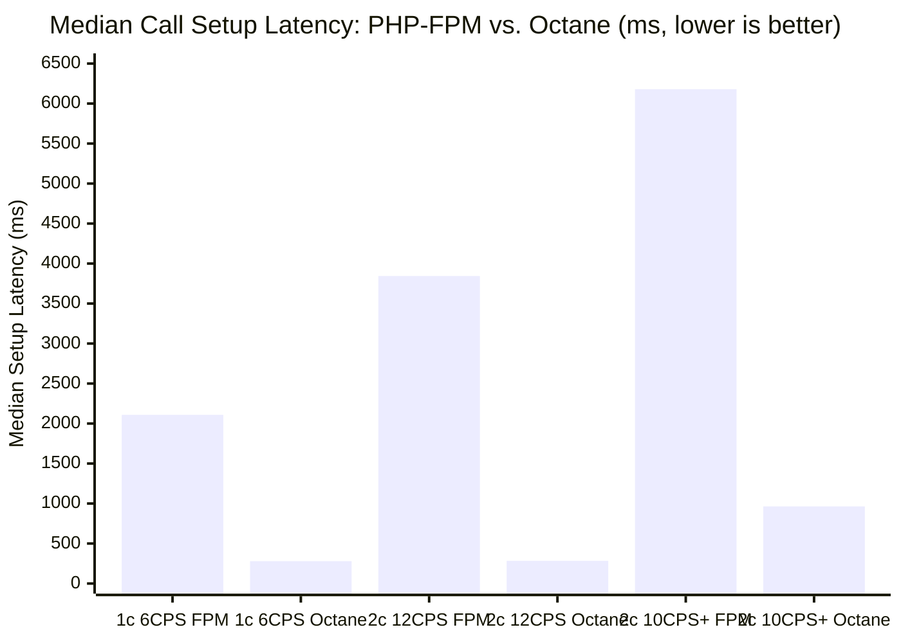
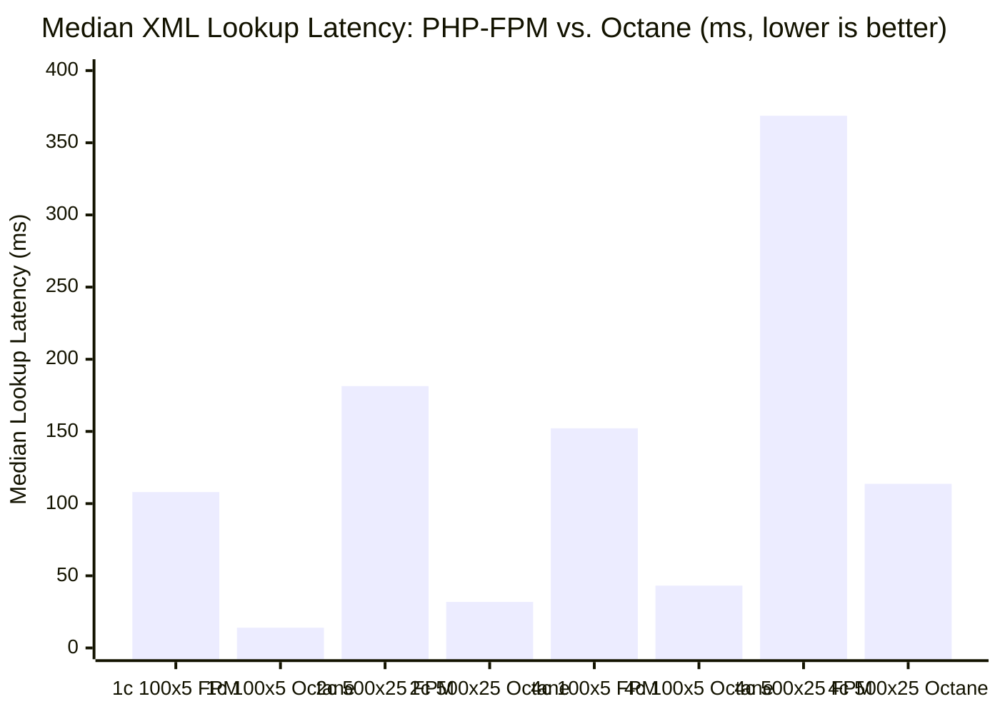

# TallPBX Load Testing Results

Use these TallPBX 5.x benchmarks to see how much call traffic different server sizes handled and how quickly they answered routing lookups. See the installation guide for operating system, storage, and minimum hardware requirements. [Server requirements](../INSTALL.md#1-create-the-server).

## Measured Call Capacity

FreeSWITCH asks TallPBX for phone account and call-routing information in XML. By default, **PHP-FPM** runs the fast XML handler, which loads only the telephony modules the lookup needs. [**Laravel Octane**](https://laravel.com/docs/octane) is an optional performance mode. It loads the same telephony module list and keeps the application loaded in memory between requests.

FreeSWITCH uses PHP-FPM when Octane is unavailable. If the fast handler catches an application error, the same PHP-FPM worker handles the request through the full application used by the web panel. [Enable, verify, or disable Octane](operations.md#octane-xml-worker-optional-performance-mode).

### Server sizes that completed every call

Use these as starting points for sizing with the default PHP-FPM handler. In the November 17, 2026 tests, each server completed every extension call offered over 60 seconds at the listed rate while handling phone registrations and one voicemail call per second. The tests used build `2fbac077`, Debian 13, and the default SQLite database for FreeSWITCH.

| Test server | Extension call rate with 100% completion | Calls completed | Phone registrations offered |
| --- | ---: | ---: | ---: |
| 1 vCPU / 1 GB RAM | **2 calls/sec** | 120 of 120 | 2/sec |
| 2 vCPU / 2 GB RAM | **8 calls/sec** | 480 of 480 | 8/sec |
| 4 shared vCPU / 8 GB RAM | No verified 60-second rate | — | — |

The 4 vCPU server passed functional call tests, and its XML lookup measurements are below. Use a separate 60-second or longer run with your expected call mix to establish a sizing target for it. The November 17 report includes short checks and higher rates where calls dropped. [November 17 test report](load-testing-2026-11-17.md#freeswitch-runtime-database) · [Run a capacity comparison](../load-testing/procedure.md#step-8--compare-call-capacity).

### PHP-FPM and Octane at the same call rate

These earlier November 8–9, 2026 runs offered extension calls for 60 seconds with 20 registered phone accounts. Each row compares the two handlers at the same offered rate on the same hardware. PHP-FPM used a dynamic worker pool when it handled XML and a fixed-size pool alongside Octane, so two settings changed. The November 17 series has no 1 vCPU Octane run.

| Test server | Offered rate | Calls completed with PHP-FPM | Calls completed with Octane |
| --- | ---: | ---: | ---: |
| 1 vCPU / 1 GB RAM | 6 calls/sec | 252 of 360 (70%) | **360 of 360 (100%)** |
| 2 vCPU / 2 GB RAM | 12 calls/sec | 299 of 720 (42%) | **720 of 720 (100%)** |

The 1 vCPU runs recorded build `dd14e57` with local changes. The 2 vCPU runs used build `1333389f`. In those sweeps, PHP-FPM also completed every call at 5 calls/sec on 1 vCPU (300 of 300) and 10 calls/sec on 2 vCPU (600 of 600). [Worker sweep data](../load-testing/results/consolidated/worker-sweep-20261108-cells.csv).

## XML Lookup Speed

The default fast PHP-FPM handler loads just the telephony modules. Optional Octane keeps the same modules loaded in memory between requests. These tests send lookup requests directly to each handler and report completed requests per second. Call capacity also depends on FreeSWITCH and what each call does.

| Test server | Date | Workload | PHP-FPM | Octane |
| --- | --- | --- | ---: | ---: |
| 1 vCPU / 1 GB RAM | Nov 4 | 100 routing requests, 5 at a time | 25.5 req/sec | 168.5 req/sec |
| 2 vCPU / 2 GB RAM | Nov 17 | 100 mixed lookups, 5 at a time | 61.9–67.0 req/sec | 297.6–320.4 req/sec |
| 4 shared vCPU / 8 GB RAM | Nov 10 | 100 mixed lookups, 5 at a time | 20.12 req/sec | 67.20 req/sec |
| 4 shared vCPU / 8 GB RAM | Nov 10 | 1,000 mixed lookups, 25 at a time | 45.08 req/sec | 140.54 req/sec |

The November 4 numbers average three runs per handler on build `62661edf` with the 60-second cache profile. The November 17 ranges show three runs per handler on build `2fbac077` using the same cache profile. Mixed lookups combine phone account and routing requests. Compare handlers within each row. The dates, hardware, and request mixes differ across rows. [November 4 interleaved results](https://github.com/tallpbx/tallpbx/blob/e03160fa087d4675b7be6ad1764565d9b8211008/load-testing/status.md#variant-comparison--interleaved-series-3-rounds) · [November 17 lookup results](load-testing-2026-11-17.md#xml-lookup-throughput).

On 4 shared vCPU, PHP-FPM used a dynamic pool capped at 12 workers. At 1,000 requests, the median response took **331 ms** with PHP-FPM and **85 ms** with Octane. The November 10 report also records a pass across 14 calling and media scenarios. It gives neither the running build SHA nor a 60-second call-rate comparison for that host. [November 10 lookup tests](https://github.com/tallpbx/tallpbx/blob/5d643e31c7d5a06c27491d448103c834e4b4d9f3/docs/load-testing-results.md#persistent-octane-worker-vs-php-fpm-comparison-4-vcpu-shared--8-gb-ram) · [November 10 calling scenarios](https://github.com/tallpbx/tallpbx/blob/5d643e31c7d5a06c27491d448103c834e4b4d9f3/docs/load-testing-results.md#4-vcpu-shared--8-gb-ram-live-call-capacity--extended-validation).

## Latency Comparison

Call capacity is only half the picture. An individual caller experiences latency directly as **post-dial delay**—the pause between dialing and hearing ringback or an answer. Even before a server starts dropping calls, worker queueing can push individual call setup times from roughly a tenth of a second to several seconds.

The charts and tables below compare **PHP-FPM** against **Laravel Octane** across measured server sizes for two metrics:

- **Individual call setup latency:** Measured per call by SIPp from the initial `INVITE` through SIP authentication (`407`), FreeSWITCH XML lookups, and `200 OK` answer. **Median (p50)** reflects a typical call; **p95** shows the slowest 5% of completed calls. Call teardown (`BYE` → `200 OK`) is verified on every completed call, though teardown duration is not separately timed in the current datasets.
- **XML lookup latency:** Direct HTTP response time for FreeSWITCH directory and dialplan lookups without SIP signaling or call audio.

### Individual call setup latency (PHP-FPM vs. Octane)

Each pair in the chart and first table compares both handlers on the same server at the same offered call rate over 60 seconds. Under these rates, PHP-FPM queues lookups and drops calls while Octane keeps typical call setup well under one second.

| Test server | Date | Workload (60 sec) | PHP-FPM median / p95 | Octane median / p95 |
| --- | --- | --- | ---: | ---: |
| 1 vCPU / 1 GB RAM | Nov 8–9 | 6 calls/sec, 20 accounts | 2,108 / 7,008 ms *(70% completed)* | **280 / 2,588 ms** *(100% completed)* |
| 2 vCPU / 2 GB RAM | Nov 9 | 12 calls/sec, 20 accounts | 3,844 / 6,860 ms *(42% completed)* | **284 / 3,972 ms** *(100% completed)* |
| 2 vCPU / 2 GB RAM | Nov 17 | 10 calls/sec + 8 reg/sec + 1 vm/sec, SQLite (`10CPS+`) | 6,180 / 17,548 ms *(56% completed)* | **964 / 5,100 ms** *(97% completed)* |
| 4 shared vCPU / 8 GB RAM | — | No verified 60-second call comparison | — | — |

Latency is reported for completed calls only. On the November 8–9 sweeps, PHP-FPM used a dynamic pool when serving XML and a fixed-size pool alongside Octane.

#### How individual call setup time changes with load (100% completed calls)

Even when every call succeeds, setup latency climbs sharply as PHP-FPM approaches its ceiling. Use this table to see what an individual caller experiences at light load versus busy load on each server size:

| Test server | Date | Handler | Offered workload (60 sec, 100% completed) | Setup median / p95 |
| --- | --- | --- | --- | ---: |
| 1 vCPU / 1 GB RAM | Nov 10 | PHP-FPM (`dynamic 3`) | 3 calls/sec, 20 accounts | **124 / 300 ms** |
| 1 vCPU / 1 GB RAM | Nov 17 | PHP-FPM (`dynamic 3`) | 2 calls/sec + 2 reg/sec + 1 vm/sec (SQLite) | **352 / 1,356 ms** |
| 1 vCPU / 1 GB RAM | Nov 8 | PHP-FPM (`dynamic 3`) | 5 calls/sec, 20 accounts | 928 / 4,376 ms |
| 1 vCPU / 1 GB RAM | Nov 9 | **Octane** | 6 calls/sec, 20 accounts | **280 / 2,588 ms** |
| 2 vCPU / 2 GB RAM | Nov 9 | PHP-FPM (`dynamic 6`) | 6 calls/sec, 20 accounts | **120 / 232 ms** |
| 2 vCPU / 2 GB RAM | Nov 17 | PHP-FPM (`dynamic 6`) | 8 calls/sec + 8 reg/sec + 1 vm/sec (SQLite) | 1,204 / 2,680 ms |
| 2 vCPU / 2 GB RAM | Nov 9 | PHP-FPM (`dynamic 6`) | 10 calls/sec, 20 accounts | 1,664 / 3,860 ms |
| 2 vCPU / 2 GB RAM | Nov 9 | **Octane** | 12 calls/sec, 20 accounts | **284 / 3,972 ms** |

[Worker sweep data](../load-testing/results/consolidated/worker-sweep-20261108-cells.csv) · [November 17 data](../load-testing/results/consolidated/refresh-20261117-cells.csv).

### XML lookup latency (PHP-FPM vs. Octane)

Direct HTTP lookup benchmarks isolate how fast TallPBX answers FreeSWITCH directory and dialplan requests without call audio or SIP signaling overhead.

| Test server | Date | Workload | PHP-FPM median / p95 | Octane median / p95 |
| --- | --- | --- | ---: | ---: |
| 1 vCPU / 1 GB RAM | Nov 5 | 100 dialplan lookups, 5 at a time (3 runs) | 108 / 120 ms | **14 / 25 ms** |
| 1 vCPU / 1 GB RAM | Nov 17 | 100 mixed lookups, 5 at a time (3 runs) | 76.7–90.7 / 121.4–129.9 ms | — *(no Nov 17 1 vCPU run)* |
| 2 vCPU / 2 GB RAM | Nov 17 | 100 mixed lookups, 5 at a time (3 runs) | 46.7–60.2 / 73.6–89.6 ms | **8.9–9.2 / 13.2–16.3 ms** |
| 2 vCPU / 2 GB RAM | Nov 17 | 500 mixed lookups, 25 at a time | 181.4 / 293.8 ms | **31.9 / 56.3 ms** |
| 4 shared vCPU / 8 GB RAM | Nov 10 | 100 mixed lookups, 5 at a time | 152.2 / — ms[^nov10-p95] | **43.2 / — ms**[^nov10-p95] |
| 4 shared vCPU / 8 GB RAM | Nov 10 | 500 mixed lookups, 25 at a time | 368.7 / — ms[^nov10-p95] | **113.7 / — ms**[^nov10-p95] |
| 4 shared vCPU / 8 GB RAM | Nov 10 | 1,000 mixed lookups, 25 at a time | 330.8 / — ms[^nov10-p95] | **85.2 / — ms**[^nov10-p95] |

[^nov10-p95]: The November 10 report recorded median and **max** (single slowest request, not p95): PHP-FPM max was 476.1 ms (`100×5`), 1,133.0 ms (`500×25`), and 1,020.0 ms (`1,000×25`), versus Octane max of 117.3 ms, 322.4 ms, and 213.2 ms. The next `h4-4c8g` run will record p95 directly.

Compare handlers within each row rather than across dates: the November 5 (build `5cbc700`), November 10 (4 shared vCPU host), and November 17 (build `2fbac077`) series ran on different builds, cloud hosts, and request mixes. Across every matched pair, Octane cut median XML lookup latency by roughly **3× to 7×**. [November 5 1 vCPU summary](operations.md#expected-gain-1-vcpu--967-mb-reference-tier) · [November 10 lookup tests](https://github.com/tallpbx/tallpbx/blob/5d643e31c7d5a06c27491d448103c834e4b4d9f3/docs/load-testing-results.md#persistent-octane-worker-vs-php-fpm-comparison-4-vcpu-shared--8-gb-ram) · [November 17 lookup results](load-testing-2026-11-17.md#xml-lookup-throughput).

## Detailed Benchmark Reports

- [November 17, 2026](load-testing-2026-11-17.md) covers call completion, lookup speed, and SQLite versus MariaDB with concurrent phone registrations and voicemail. [Consolidated data](../load-testing/results/consolidated/refresh-20261117-cells.csv).
- The November 8–9 worker sweeps explain the installer's PHP-FPM worker limits on the [1 vCPU host](https://github.com/tallpbx/tallpbx/blob/2d6ca813902f016899f118edd5b3b22ac4fa6354/docs/load-testing-results.md#pre-2vcpu-verification-block-and-default-selection-1-vcpu--1-gb-2026-11-09) and the [2 vCPU host](https://github.com/tallpbx/tallpbx/blob/2d6ca813902f016899f118edd5b3b22ac4fa6354/docs/load-testing-results.md#2-vcpu--2-gb-capacity-ladder-and-worker-sweep-2026-11-09).
- [November 4–5, 2026](https://github.com/tallpbx/tallpbx/blob/dd14e5772428b675ef673f425447b31d09725fc0/load-testing/results/refresh-20261103/summary.md#1-call-capacity-ladder--cdr-via-php-fpm-the-shipped-default) records the earlier 1 vCPU call-rate ladder. Use it for historical context alongside the [November 5 follow-up](https://github.com/tallpbx/tallpbx/blob/dd14e5772428b675ef673f425447b31d09725fc0/load-testing/results/refresh-20261105-slimboot-sip/summary.md#results).

[Benchmark procedure](../load-testing/README.md) · [Metric definitions](load-testing-guide.md#interpreting-test-metrics).
