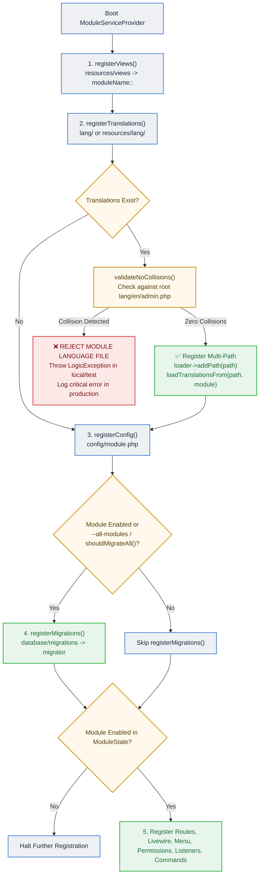

# TallPBX Modular Architecture & Translation Guide

This document is the authoritative architectural and developer reference for TallPBX's modular architecture (`app-modules/`), service provider lifecycle, and modular translation system. It provides administrators and developers with the design rationale, conventions, runtime guards, and scaffolding workflows used throughout the project.

---

## 1. Domain-Driven Modular Monolith Architecture

TallPBX 4.x organizes its telecommunications, administrative, and PBX capabilities as a **Domain-Driven Modular Monolith**. Rather than maintaining all models, controllers, Livewire components, routes, migrations, and translation strings in a single monolithic `app/` directory or treating internal modules as fragile pseudo-packages, each domain feature (such as `gateways`, `extensions`, `sip-profiles`, `voicemails`, `security`, and `backups`) is encapsulated into a cohesive **bounded context** in `app-modules/`.

### Core Architectural Principles
1. **Single Deployable Monolith**: All built-in modules belong to the unified core codebase and update atomically via Git. They are NOT independent microservices or separate Composer packages.
2. **Direct Root PSR-4 Autoloading**: All built-in modules are mapped directly in root `composer.json` via standard PSR-4 (`Modules\{Domain}\` => `app-modules/{domain}/src/`). Root `composer.json` contains 0 path repositories and 0 `tallpbx/module-*` package requirements.
3. **No Physical Deletion of Core Modules**: Built-in modules in `app-modules/` are permanent parts of the system and are never deleted from disk. Disabling a module is strictly logical (`enabled = false` in the database registry, suppressing route, view, and provider registration).
4. **Clean Extensibility Boundary (`custom-modules/` & `vendor/`)**: Third-party community extensions reside in the untracked, git-ignored `custom-modules/{name}/` directory or in standard Composer packages under `vendor/`. External extensions are guarded by strict Pre-flight Collision Guards (Route, Database Schema, Module Name, Language Keys, and Permissions).
5. **Standardized Base Service Provider**: All modules boot via a child class extending `App\Support\ModuleServiceProvider`, eliminating repetitive boilerplate for views, migrations, routes, Livewire components, permissions, and translations.
6. **Decoupled Cross-Domain Communication**: High cohesion within domains, low coupling between domains. Modules communicate through Laravel events, service contracts, or published interfaces rather than deep cross-domain database coupling.
7. **Zero-Friction Scaffolding**: The Artisan command `php artisan make:module <name>` scaffolds production-ready modules conforming strictly to project conventions.

---

## 2. Directory Layout of a Module

Each module under `app-modules/{module-name}/` follows a standardized layout:

```
app-modules/{module-name}/
├── module.json                 # TallPBX module manifest (schema, display name, category)
├── config/                     # Optional module configuration merged over defaults
│   └── {module-name}.php
├── database/
│   └── migrations/             # Database migrations auto-loaded by provider
├── lang/                       # Modular translation dictionaries (en, es, fr)
│   ├── en/
│   │   ├── admin.php           # Admin panel strings for this module
│   │   └── client.php          # Tenant portal strings (if module has client UI)
│   ├── es/
│   │   └── admin.php
│   └── fr/
│       └── admin.php
├── resources/
│   └── views/                  # Blade views auto-registered under {module-name}:: namespace
│       └── index.blade.php
├── routes/                     # Optional route definition (web.php / api.php)
├── src/
│   ├── Database/
│   │   └── Factories/          # Model factories for testing and seeding
│   ├── Livewire/               # Livewire 4 full-page workbenches and modals
│   ├── Models/                 # Eloquent models
│   ├── Providers/
│   │   └── ModuleServiceProvider.php # Module registration provider
│   └── Services/               # Domain business logic and FreeSWITCH interfaces
└── tests/                      # Automated Pest unit and feature tests
```

---

## 3. ModuleServiceProvider Lifecycle

All module service providers extend `App\Support\ModuleServiceProvider` (which extends `Illuminate\Support\ServiceProvider`). During application booting, the base provider executes a structured sequence:



### 3.1 Migration Gating and `--all-modules` Flag

By default, disabled modules do not register their database migrations. This ensures standard maintenance commands like `php artisan migrate` only mutate the database schema for active, enabled modules and the shared kernel.

When an administrator or automated deployment script needs to retain or run database migrations across all installed modules regardless of enablement state, pass the global `--all-modules` flag:
```bash
php artisan migrate --all-modules
```
Programmatic tests and maintenance jobs can control this behavior using `ModuleState::setForceAllModulesMigrations(true)`.

---

## 4. Modular Translation Architecture (Unified Language Files)

TallPBX allows each module to keep its own translation files while automatically merging them into the main application dictionaries (`admin` and `client`). This keeps module text organized inside each module folder without requiring changes to existing views, buttons, or translation calls.

### 4.1 How It Works & Why It Matters
- **Clean Standard Calls**: Templates continue using standard translation calls like `__('admin.gateway_host')`. Developers do not need to add package prefixes like `__('gateways::admin.gateway_host')`.
- **Consistent UI Buttons**: Common action buttons (`Save`, `Cancel`, `Edit`, `Delete`) remain completely uniform and reliable across English, Spanish, and French.
- **Module Independence**: Module text lives directly inside `app-modules/{module}/lang/{locale}/admin.php`, so translations stay right beside the views and logic that use them.
- **Automatic Fallback & Merging**: When a page requests text, the translation system checks the module folder first and falls back to the main system language files.

### 4.2 Avoiding Overlapping Names (Key Collisions)
Because module translations merge into the shared language dictionary (`admin`), a key in a module file could accidentally overwrite a shared system button if both shared the exact same name.

To keep translations reliable and safe:
1. **Shared System Words Stay in Root (`lang/{locale}/admin.php`)**:
   - Universal action labels (`Save`, `Cancel`, `Delete`, `Edit`, `Filter`, `Actions`, `Enabled`, `Disabled`, `Status`, `Back`) belong exclusively in the main root dictionary.
   - Main navigation menu names (`Gateways`, `Extensions`, `SIP Profiles`) live in root so menus always display correctly even if a module is temporarily stopped.
2. **Module Keys Use Descriptive Names**:
   - Every translation key in a module file must include the feature or entity name (for example: `gateway_host`, `gateway_name_tooltip`, `create_gateway`, `no_gateways_found`).
   - Module files must never define generic words like `save` or `delete`.

### 4.3 Mandatory Module Language File Header Comment
Every module language file (`app-modules/{module}/lang/{en,es,fr}/admin.php`) must begin with the standardized collision warning docblock:

```php
<?php

/**
 * --------------------------------------------------------------------------
 * Module Language Lines: {displayName} ({module_name})
 * --------------------------------------------------------------------------
 *
 * COLLISION PREVENTION & KEY NAMING RULES:
 * Under TallPBX's multi-path cascading translation architecture, module
 * language files merge directly into the global group dictionary (e.g. 'admin')
 * at runtime.
 *
 * To prevent collisions across modules or with the root dictionary:
 * 1. Every key defined in this file MUST include the module/entity name
 *    (e.g. '{entity}_host', 'create_{entity}', 'no_{entities}_found').
 * 2. Generic keys (e.g. 'save', 'cancel', 'delete', 'edit', 'enabled', 'disabled',
 *    'status', 'actions') belong strictly in root lang/{locale}/admin.php and
 *    must NEVER be defined in module language files.
 * 3. Module language files will be rejected at runtime by ModuleServiceProvider
 *    if any collision with root language keys is detected.
 */

return [
    // ...
];
```

### 4.4 Runtime Collision Guard
During module boot, `App\Support\ModuleServiceProvider` validates that module language files do not collide with root keys:
- The provider parses keys from the module's `lang/en/{group}.php`.
- It computes the intersection with the root `lang/en/{group}.php` keys.
- **Fail-Fast Enforcement**:
  - In `local` and `testing` environments: throws a `LogicException`:
    ```
    Module [gateways] language file [admin] collides with root dictionary for key(s): [save, delete]. Refusing to load.
    ```
  - In `production`: logs a critical alert to `Log::critical()` and skips loading the colliding module file, protecting the integrity of the root dictionary.

### 4.5 Automated Architecture Test Suite (`TranslationParityTest`)
The test suite at `tests/Feature/Architecture/TranslationParityTest.php` runs on every CI run and local test cycle:
- **Zero Root Collisions**: Asserts that no module language file defines any key that exists in root `lang/{locale}/admin.php`.
- **Zero Cross-Module Collisions**: Asserts that no two modules define the same translation key.
- **Entity Domain Relevance**: Asserts that keys defined in a module include the module or entity domain identifier.
- **100% Locale Parity**: Asserts that every key defined in `en` exists with identical keys in `es` (Spanish) and `fr` (French).

---

## 5. Scaffolding Custom Extensions with Artisan (`make:module`)

In the Domain-Driven Modular Monolith, built-in modules (`app-modules/`) are part of the permanent appliance monorepo maintained directly in version control. To keep the developer experience clean and avoid fragile runtime mutations of root `composer.json`, the scaffolding command `php artisan make:module` is dedicated exclusively to generating **third-party community extensions and plugins** in `custom-modules/`:

```bash
php artisan make:module my-crm-connector \
    --display-name="My CRM Connector" \
    --description="Third-party CRM integration for customer lookups" \
    --category="Integrations"
```

### Key Behaviors:
- **Target Location**: Scaffolds directly into `custom-modules/{name}/` (untracked, git-ignored).
- **Zero Root Mutation**: Leaves root `composer.json` completely untouched.
- **Manifest (`module.json`)**: Generates the standard manifest tagged with `source: "custom"`, setting up namespace (`CustomModules\{Studly}`), display name, category, and dependencies.
- **Service Provider**: Generates `src/Providers/ModuleServiceProvider.php` extending `App\Support\ModuleServiceProvider` with `moduleNamespace()` returning `CustomModules\{Studly}`.
- **Instant Dynamic Autoloading**: Automatically discovered and autoloaded at runtime via `CustomModuleAutoloader` (`CustomModules\` namespace) without running `composer dump-autoload`.
- **Component Stubs**: Pre-generates boilerplate Livewire component directories, model factories, Blade views, migration directories, and collision-safe translation files (`lang/{en,es,fr}/admin.php`).
- **Core Collision Protection**: Rejects names that collide with existing core modules in `app-modules/` (e.g. `php artisan make:module extensions` will fail with an error).

### 5.1 Distributing Custom Modules as Composer Packages (`vendor/`)

While developing locally in `custom-modules/` provides instant zero-build feedback, custom modules can also be packaged and installed as **Composer packages in `vendor/`** (`source: "vendor"`). This allows teams and community authors to distribute modular extensions via private Git repositories, Packagist, or Satis.

#### Step-by-Step Workflow:

1. **Scaffold the Module Locally**:
   Start by generating the module skeleton in `custom-modules/`:
   ```bash
   php artisan make:module my-crm-connector \
       --display-name="My CRM Connector" \
       --category="custom"
   ```

2. **Publish to an External Git Repository**:
   Initialize a dedicated Git repository (e.g. on GitHub or GitLab) and copy the generated files from `custom-modules/my-crm-connector/` into the new repository.

3. **Add a Root `composer.json` to Your Module Repository**:
   In the root of your standalone module repository, create a standard `composer.json` defining the package name and PSR-4 autoloading:
   ```json
   {
       "name": "acme/tallpbx-crm-connector",
       "description": "Third-party CRM connector for TallPBX",
       "type": "library",
       "license": "proprietary",
       "autoload": {
           "psr-4": {
               "CustomModules\\MyCrmConnector\\": "src/"
           }
       },
       "extra": {
           "tallpbx": {
               "module": true
           }
       }
   }
   ```
   *(Note: Set the `"source": "vendor"` field in your module's `module.json` to reflect that it is installed as a Composer package).*

4. **Install via Composer in TallPBX**:
   Remove the local development folder `custom-modules/my-crm-connector/` to prevent name collision guards from blocking the vendor package. Then add your Git repository and require the package in TallPBX's root `composer.json`:
   ```bash
   # Add private repository (if hosted privately on GitHub)
   composer config repositories.crm-connector vcs https://github.com/your-org/tallpbx-crm-connector.git

   # Install the package
   composer require acme/tallpbx-crm-connector
   ```

5. **Discovery & Activation**:
   TallPBX's discovery scanner inspects `vendor/*/*/module.json` on boot and caches the discovered manifest (`bootstrap/cache/modules.php`). Synchronize and activate the extension:
   ```bash
   php artisan module:sync
   ```
   The module will appear in `/panel/modules` under the **Custom** category with a `"Vendor"` source tag, and can be enabled, disabled, or uninstalled (`module:uninstall`) directly from the panel or CLI.

---

## 6. Translation Authoring Guidelines

When creating translation keys for a module:
1. **Module Domain Prefixing**: Every key defined in `app-modules/{module}/lang/{en,es,fr}/admin.php` must include the entity or domain name (e.g. `gateway_*`, `create_gateway`, `modal_delete_gateway_title`).
2. **Root Action Keys**: Generic action labels (`save`, `delete`, `edit`, `cancel`, `enabled`, `disabled`, `status`, `actions`) belong strictly in root `lang/{locale}/admin.php` and must never be defined in module dictionaries.
3. **Locale Parity**: All module keys must be populated across all supported languages (`en`, `es`, `fr`).
4. **Header Docblock**: All module translation files must begin with the collision prevention docblock.
5. **Verification**: Verify that keys follow all collision and parity rules:
   ```bash
   php artisan optimize:clear
   ./vendor/bin/pest tests/Feature/Architecture/TranslationParityTest.php
   ```

---

## 7. Multi-Source Discovery, Boot Guards & Custom Extension Lifecycle

### 7.1 Why Path Repositories Were Replaced With Direct PSR-4

TallPBX 3.x registered each of its 60 built-in modules as a Composer **path repository** with a
`tallpbx/module-*` require entry. That design had three compounding costs:

1. **Composer execution time**: every `composer` invocation resolved and symlinked 60 path
   packages, pushing autoloader generation from under 2 seconds to over a minute on modest
   hardware.
2. **Fragile boot coupling**: modules registered their providers through
   `extra.laravel.providers` inside per-module `composer.json` files; deleting a module directory
   without a perfect Composer dance left the installation un-bootable.
3. **Extension blur**: first-party code was packaged as if it were third-party, so the Git
   updater and module lifecycle constantly negotiated with Composer state.

TallPBX 4.x replaces all of it with **direct root PSR-4 autoloading**
(`Modules\{Domain}\` => `app-modules/{domain}/src/`) plus a manifest-driven discovery engine
(`App\Providers\ModuleServiceProvider`). Root `composer.json` carries zero path repositories and
zero `tallpbx/module-*` requirements, and the vestigial per-module `composer.json` files are gone.

### 7.2 Multi-Source Discovery

Discovery scans three locations and tags every module with a `source`:

| Source | Location | Autoloading |
| :--- | :--- | :--- |
| `core` | `app-modules/*/module.json` | Root PSR-4 |
| `custom` | `custom-modules/*/module.json` | Runtime `CustomModuleAutoloader` (`CustomModules\{Name}\`) |
| `vendor` | `vendor/*/*/module.json` | Composer classmap |

Parsed manifests are cached to `bootstrap/cache/modules.php` (regenerated by `module:sync`,
`module:cache`, `make:module`, and `optimize:clear`). Both the cold scan and the cached path run
the same boot guards, so behavior never depends on cache state.

### 7.3 Pre-Flight & Runtime Collision Guards (`App\Services\ModuleCollisionGuard`)

Third-party extensions are untrusted code. Before and during registration the appliance enforces:

| Guard | Rule | Enforcement point |
| :--- | :--- | :--- |
| Module name | A custom module may not shadow an installed module's name — rejected with a logged error | Discovery merge + cached-path validation |
| Route boundaries | Custom route files may not bind reserved panel URLs (`/panel/login`, `/panel/setup`, `/panel/dashboard`, `/panel/settings`, `/panel/modules`, `/panel/git-update`) or hijack existing route names; offending files are never loaded | Static pre-flight scan + post-load router audit |
| Database schema | Custom migrations may not create existing tables or touch protected core tables (`users`, `admins`, `tenants`, `groups`, `permissions`, `modules`, `menus`) — the run halts with `MigrationCollisionException` | Static token scan + runtime `beforeExecuting` DDL watch |
| Language keys | Custom translations colliding with another module's dictionary lose their global shortcut and fall back to namespaced `{module}::` lookups | `App\Support\ModuleServiceProvider` inter-module registry |
| Permissions | Custom modules cannot claim permissions already owned by another module | `PermissionService` ownership guard |
| Dependencies | Unmet `requirements.modules` or `requirements.packages` disable the module (manifest + registry + provider skip) with a critical log instead of crashing the appliance — on both boot paths | Discovery fail-soft check |

### 7.4 Custom Extension Lifecycle

| Action | Core (`app-modules/`) | Custom (`custom-modules/`) | Vendor (`vendor/`) |
| :--- | :--- | :--- | :--- |
| Disable | `/panel/modules` toggle | `/panel/modules` toggle | `/panel/modules` toggle |
| Uninstall | **Refused** — permanent monorepo code | `module:uninstall` with typed confirmation (`UNINSTALL {name}`); directory and registry record deleted; **irreversible** | `module:uninstall` — removed via Composer |
| Restore | N/A (never uninstalled) | N/A (untracked — nothing to restore from) | `module:restore` — Composer re-require from the recorded package |

`module:sync` prunes ghost core registry rows (a `source = 'core'` row whose directory is gone is
always dead) while preserving custom/vendor rows so unplugged extensions keep their state.

Scaffold new extensions with `php artisan make:module <name>` — it writes to
`custom-modules/{name}/` only, tags the manifest `source: custom`, and refreshes the manifest
cache. Route auto-registration (Livewire `List`/`Edit` component conventions) and dialplan XML
hooks (`DialplanXmlContributor`) work identically for custom modules and core modules.

### 7.5 Backups: System Superadmin Disaster Recovery

The Backups module is a required Core Administration utility (`required: true` — it cannot be
disabled) that owns its own routes, menu entry, and permissions. Third-party extensions ride with
the "Application files" backup scope: `custom-modules/` is captured into every backup that includes
that scope, included in pre-restore rollback snapshots, and restored module-by-module — extensions
installed after a backup are left untouched. See the Security Center documentation for
firewall-adjacent restore safety rules.

---

## 8. Related Documentation

- [Telephony Fundamentals: Users, Extensions, SIP Accounts & Devices](telephony-architecture.md) — Comprehensive, accessible guide to how core VoIP entities relate to one another.
- [PBX "Hello World" Quickstart](pbx-hello-world.md) — Create an extension and test your first call with an audio echo test (`*9196`).
- [Security Architecture & Packet Flow Guide](security-architecture.md) — How TallPBX defends phone traffic with kernel-level packet filtering.
- [User Interface Tour](ui-tour.md) — Visual guide to the TallPBX control panel workbenches.

