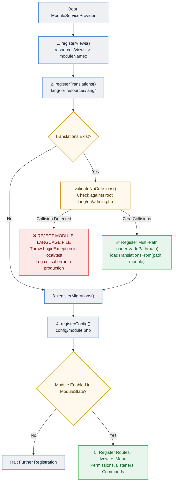

# TallPBX Modular Architecture & Translation Guide

This document is the authoritative architectural and developer reference for TallPBX's modular architecture (`app-modules/`), service provider lifecycle, and modular translation system. It provides administrators and developers with the design rationale, conventions, runtime guards, and scaffolding workflows used throughout the project.

---

## 1. Modular Architecture Overview

TallPBX organizes its telecommunications and administration features into self-contained modules located in the `app-modules/` directory. Rather than housing all models, controllers, Livewire components, routes, migrations, and translation strings in a single monolithic `app/` directory, each domain feature (such as `gateways`, `extensions`, `sip-profiles`, `voicemails`, `security`, and `firewall`) is encapsulated in its own module.

### Core Architectural Principles
1. **Self-Contained Domains**: A module owns its Livewire components, Eloquent models, domain services, database migrations, Blade views, and language dictionaries.
2. **Standardized Base Service Provider**: All modules boot via a child class extending `App\Support\ModuleServiceProvider`, eliminating repetitive boilerplate for views, migrations, routes, Livewire components, permissions, and translations.
3. **Decoupled Package Discovery**: Modules are discovered via Composer path repositories and Laravel package discovery, keeping each module independently testable.
4. **Zero-Friction Scaffolding**: The Artisan command `php artisan make:module <name>` scaffolds production-ready modules conforming strictly to project conventions.

---

## 2. Directory Layout of a Module

Each module under `app-modules/{module-name}/` follows a standardized layout:

```
app-modules/{module-name}/
├── composer.json               # Package definition and PSR-4 autoloading
├── module.json                 # TallPBX module manifest (schema, display name, category)
├── config/                     # Optional module configuration merged over defaults
│   └── {module-name}.php
├── database/
│   └── migrations/             # Database migrations auto-loaded by provider
├── lang/                       # Modular translation dictionaries (en, es, fr)
│   ├── en/
│   │   ├── admin.php           # Admin panel strings for this module
│   │   └── client.php          # Tenant portal strings (if module has client UI)
│   ├── es/
│   │   └── admin.php
│   └── fr/
│       └── admin.php
├── resources/
│   └── views/                  # Blade views auto-registered under {module-name}:: namespace
│       └── index.blade.php
├── routes/                     # Optional route definition (web.php / api.php)
├── src/
│   ├── Database/
│   │   └── Factories/          # Model factories for testing and seeding
│   ├── Livewire/               # Livewire 4 full-page workbenches and modals
│   ├── Models/                 # Eloquent models
│   ├── Providers/
│   │   └── ModuleServiceProvider.php # Module registration provider
│   └── Services/               # Domain business logic and FreeSWITCH interfaces
└── tests/                      # Automated Pest unit and feature tests
```

---

## 3. ModuleServiceProvider Lifecycle

All module service providers extend `App\Support\ModuleServiceProvider` (which extends `Illuminate\Support\ServiceProvider`). During application booting, the base provider executes a structured sequence:



---

## 4. Modular Translation Architecture (Native Path Cascading)

TallPBX uses **Option A: Native Path Cascading** via Laravel's translation `FileLoader::addPath()`. This design moves module-specific strings out of the monolithic root files while ensuring **zero UI presentation changes, zero template rewrites, and immutable button identifiers**.

### 4.1 Why Native Path Cascading?
- **Zero Template Churn**: Blade views, Livewire components, Form Requests, and models retain their existing `__('admin.key_name')` calls. No view has to be updated to a package namespace like `__('gateways::admin.key')`.
- **Immutable Button Identifiers**: Core button identifiers (`button_save`, `save`, `cancel`, `edit`, `delete`) remain completely stable. UI presentation in English, Spanish, and French is **100% frozen and identical**.
- **Physical Module Encapsulation**: Module strings live in `app-modules/{module}/lang/{locale}/admin.php`, allowing developers to inspect and maintain module translations right alongside module views and code.
- **Native Multi-Path Resolution**: In Laravel 13, `Illuminate\Translation\FileLoader` merges registered paths sequentially via `array_replace_recursive()`. Calling `__('admin.gateway_host')` resolves directly from `app-modules/gateways/lang/en/admin.php` without prefix rewriting.

### 4.2 The Collision Hazard & Strict Key Partitioning
Because cascading paths merge directly into the global group dictionary (`admin`), any key defined in a module language file that matches a root key would overwrite that root key globally.

To prevent dictionary corruption:
1. **Root Global Dictionary Sanctity (`lang/{locale}/admin.php`)**:
   - Generic actions (`save`, `cancel`, `delete`, `edit`, `filter`, `actions`, `enabled`, `disabled`, `status`, `confirm`, `back`) belong **strictly** to the root dictionary.
   - Global navigation menu labels (`admin.gateways`, `admin.extensions`, `admin.sip_profiles`) remain in the root dictionary so navigation renders regardless of module load states.
   - Shell banners, tenant context headers, and global system messages remain in root.
2. **Module Key Domain Relevance**:
   - Every key defined in a module language file **must** include the module or entity domain in its identifier (e.g. `gateway_host`, `gateway_name_tooltip`, `create_gateway`, `modal_delete_gateway_title`, `no_gateways_found`, `sip_trunk_port`).
   - Module language files must **never** define generic action keys like `save` or `delete`.

### 4.3 Mandatory Module Language File Header Comment
Every module language file (`app-modules/{module}/lang/{en,es,fr}/admin.php`) must begin with the standardized collision warning docblock:

```php
<?php

/**
 * --------------------------------------------------------------------------
 * Module Language Lines: {displayName} ({module_name})
 * --------------------------------------------------------------------------
 *
 * COLLISION PREVENTION & KEY NAMING RULES:
 * Under TallPBX's multi-path cascading translation architecture, module
 * language files merge directly into the global group dictionary (e.g. 'admin')
 * at runtime.
 *
 * To prevent collisions across modules or with the root dictionary:
 * 1. Every key defined in this file MUST include the module/entity name
 *    (e.g. '{entity}_host', 'create_{entity}', 'no_{entities}_found').
 * 2. Generic keys (e.g. 'save', 'cancel', 'delete', 'edit', 'enabled', 'disabled',
 *    'status', 'actions') belong strictly in root lang/{locale}/admin.php and
 *    must NEVER be defined in module language files.
 * 3. Module language files will be rejected at runtime by ModuleServiceProvider
 *    if any collision with root language keys is detected.
 */

return [
    // ...
];
```

### 4.4 Runtime Collision Guard
During module boot, `App\Support\ModuleServiceProvider` validates that module language files do not collide with root keys:
- The provider parses keys from the module's `lang/en/{group}.php`.
- It computes the intersection with the root `lang/en/{group}.php` keys.
- **Fail-Fast Enforcement**:
  - In `local` and `testing` environments: throws a `LogicException`:
    ```
    Module [gateways] language file [admin] collides with root dictionary for key(s): [save, delete]. Refusing to load.
    ```
  - In `production`: logs a critical alert to `Log::critical()` and skips adding the cascading path, protecting the integrity of the root dictionary.

### 4.5 Automated Architecture Test Suite (`TranslationParityTest`)
The test suite at `tests/Feature/Architecture/TranslationParityTest.php` runs on every CI run and local test cycle:
- **Zero Root Collisions**: Asserts that no module language file defines any key that exists in root `lang/{locale}/admin.php`.
- **Zero Cross-Module Collisions**: Asserts that no two modules define the same translation key.
- **Entity Domain Relevance**: Asserts that keys defined in a module include the module or entity domain identifier.
- **100% Locale Parity**: Asserts that every key defined in `en` exists with identical keys in `es` (Spanish) and `fr` (French).

---

## 5. Scaffolding Modules with Artisan

When creating a new module, use the built-in generator command:

```bash
php artisan make:module call-forwarding \
    --display-name="Call Forwarding" \
    --description="Manage user and extension call redirection rules" \
    --category="Telephony"
```

The command automatically scaffolds the complete module tree, including:
- `lang/en/admin.php` with the collision warning header docblock.
- `lang/es/admin.php` with the collision warning header docblock.
- `lang/fr/admin.php` with the collision warning header docblock.
- `src/Providers/ModuleServiceProvider.php`.
- `resources/views/index.blade.php`.
- `module.json` and `composer.json`.

---

## 6. Migration Guide for Existing Modules

When moving keys from root `lang/{locale}/admin.php` to a module:
1. **Identify Module Keys**: Identify keys in `lang/en/admin.php` specific to the module (e.g. `gateway_*`, `create_gateway`, `modal_delete_gateway_title`).
2. **Verify Entity Name Inclusion**: Ensure all identified keys include the domain/entity name. Generic keys (`save`, `delete`, `edit`) must stay in root.
3. **Extract Keys with Locale Parity**: Create `app-modules/{module}/lang/{en,es,fr}/admin.php` containing the mandatory header docblock and the translated strings for English, Spanish, and French.
4. **Remove from Root**: Delete the extracted keys from root `lang/en/admin.php`, `lang/es/admin.php`, and `lang/fr/admin.php`.
5. **Preserve Views**: Do **not** touch any Blade views or Livewire components. The cascading loader resolves keys seamlessly.
6. **Rebuild Cache & Test**:
   ```bash
   php artisan optimize:clear
   ./vendor/bin/pest tests/Feature/Architecture/TranslationParityTest.php
   ```
