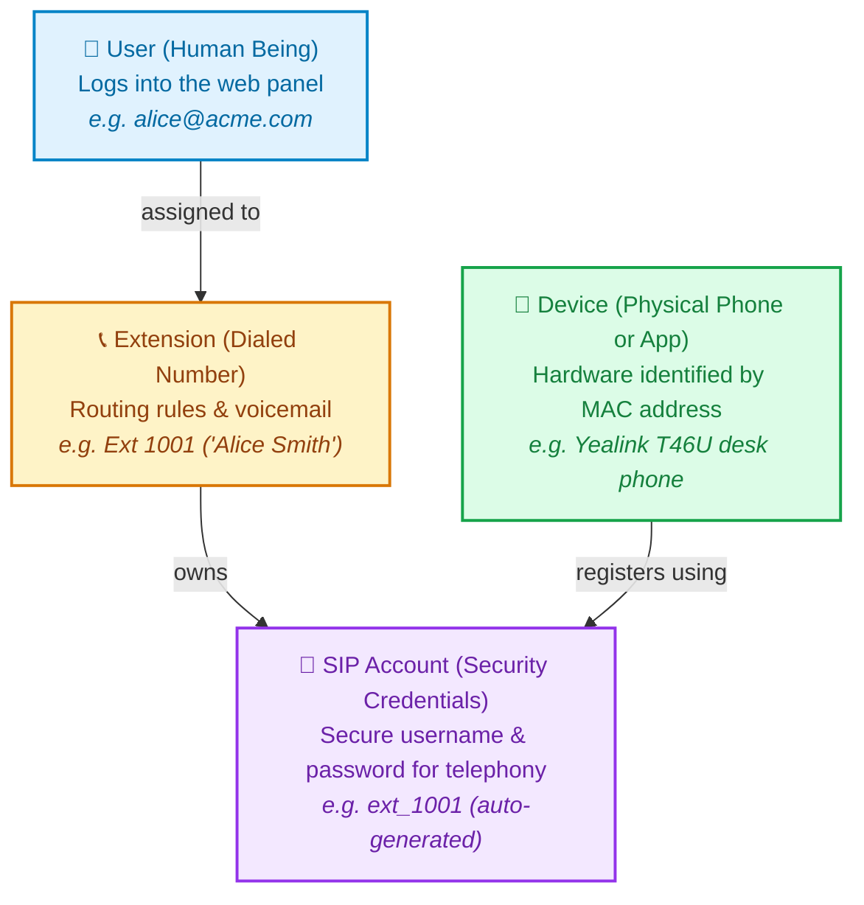

# Telephony Fundamentals: Users, Extensions, SIP Accounts & Devices

If you are new to VoIP or business phone systems, terms like *extension*, *SIP account*, *user*, and *device* can easily sound like different names for the same thing. 

In older or simpler phone systems, they often were mashed together. But in a modern system like TallPBX, each one has a specific, distinct job. 

This guide breaks down each piece in plain, non-technical language first, followed by real-world examples and deeper details for technical readers.

> **Where does a *tenant* fit in?** Every user, extension, SIP account, and device below belongs to a **tenant** — the organization or customer on the phone system. To learn what a tenant is and how tenants stay separate, see [Tenants & Multi-Tenancy](multi-tenancy.md).

---

## The Quick Analogy: Office Mail & Desks

Think of how an office handles communication for a team member:

| Concept | Everyday Analogy | What It Does in TallPBX |
| :--- | :--- | :--- |
| **User** | **The Person (Employee)** | The human being who logs in to the web browser to check their voicemail, view call history, or set call forwarding. |
| **Extension** | **The Mailbox / Extension Number** | The logical phone number people dial (e.g. `1001`). It decides *where* calls go (e.g. ring a desk phone, forward to a mobile phone, or go to voicemail). |
| **SIP Account** | **The Security Keycard & Password** | The secret digital credentials that allow a phone to connect securely to the phone system behind the scenes. |
| **Device** | **The Physical Desk Phone or App** | The physical piece of hardware on the desk (like a Yealink or Polycom phone) or a softphone app on a smartphone or computer. |

---

## Visual Diagram

Here is how the four pieces connect to each other:

---

## Detailed Breakdown of Each Concept

### 1. User: The Human Being 👤
* **What it is**: A person's web login account.
* **How they use it**: The employee opens a web browser, goes to the TallPBX login page, and enters their email and password.
* **What they can do**:
  - Listen to or download their voicemails.
  - View their recent missed, received, and dialed calls.
  - Turn on call-forwarding when leaving the office.
  - Send and receive digital faxes.
* **Why it is separate**: A person might manage multiple phone extensions (for example, their direct desk extension `101` and a customer support ring group `200`). Conversely, some extensions (like an elevator phone or conference room) don't need a human web user at all.

---

### 2. Extension: The Phone Number & Routing Rules 📞
* **What it is**: The telephone number that people dial (e.g. `1001`, `1002`, `200`).
* **How it works**:
  - When someone dials `1001`, the extension tells the phone system what to do: *"Ring Alice's desk phone for 20 seconds. If she doesn't answer, forward the call to her mobile phone. If still no answer, take a voicemail and email her the audio recording."*
* **Why it is separate**: You can change your desk phone, upgrade your hardware, or log in from a new computer without ever changing your extension number. Your callers still dial `1001`, regardless of which physical phone you are using today.

---

### 3. SIP Account: The Telephony Security Credentials 🔑
* **What it is**: The secure username and cryptographic password used by the phone engine (FreeSWITCH) to authenticate calls.
* **How it works**:
  - Just like your email client (like Outlook or Apple Mail) needs secret server credentials to fetch emails, a VoIP phone needs secret SIP credentials to place and receive phone calls.
  - TallPBX automatically creates and secures these credentials for you.
* **Why it is separate**: 
  - **Security**: Your web login password should never be transmitted over phone lines or stored inside a phone sitting on an office desk. If an attacker stole a desk phone, they would never gain access to your web control panel.
  - **Multiple Devices**: By separating the SIP account from the extension, an employee can have a desk phone, a laptop softphone, and a mobile app all connected to the same extension without password collisions.

---

### 4. Device: The Physical Hardware or Softphone App 📠
* **What it is**: The actual physical object sitting on a desk (e.g. a Yealink, Polycom, or Grandstream phone) or a softphone app installed on a smartphone/PC.
* **How it works**:
  - Every physical network device in the world has a permanent, unique serial identifier called a **MAC address** (looks like `00:15:65:4A:2B:11`, printed on the barcode sticker on the back of the phone).
* **Zero-Touch Auto-Provisioning**:
  - When an administrator enters the phone's MAC address into TallPBX, the system can automatically configure the phone.
  - When the phone is plugged into power and an internet cable, it connects to TallPBX, downloads its settings and SIP Account credentials, and configures its own buttons and screen automatically—no manual typing required on the phone's small keypad!

---

## A Real-World Walkthrough: Onboarding "Alice"

To see how straightforward this is in practice, here is what happens when a company hires a new employee named Alice:

1. **Create the User**: The office manager adds Alice (`alice@acme.com`). Alice receives a welcome email to log in to the employee portal.
2. **Create Extension 1001**: The manager creates extension `1001` with caller ID "Alice Smith" and assigns it to Alice. Behind the scenes, TallPBX automatically generates a secure **SIP Account**.
3. **Assign a Device**: The IT administrator takes a brand-new Yealink desk phone out of its box and types its MAC address into TallPBX, linking it to Alice's extension.
4. **Plug & Play**: Alice plugs the phone into her desk Ethernet jack. The phone boots up, automatically downloads its setup from TallPBX, and lights up showing "Alice Smith - 1001".
5. **Making Calls**: When a customer calls `1001`, Alice's desk phone rings. If she is away, she logs into the web portal from her home laptop using her **User** account to check her voicemail.

---

## Summary Reference Table

| Question | User 👤 | Extension 📞 | SIP Account 🔑 | Device 📠 |
|---|---|---|---|---|
| **What is it?** | A human being | A dialed number | Security credentials | A piece of hardware / app |
| **Identifier** | Email address | Number (e.g. `1001`) | Auth username | MAC address (`00:15:...`) |
| **Primary Location** | Web browser / Portal | Dialplan / Routing | Telephony server engine | Office desk / Mobile phone |
| **Can one exist without the others?** | Yes (Admins who don't need a phone) | Yes (Virtual extensions / IVR menus) | No (Always belongs to an extension) | Yes (Unassigned spare phones in stock) |

---

## Related Documentation

- [PBX "Hello World" Quickstart](pbx-hello-world.md) — Create an extension and test your first call with an audio echo test (`*9196`).
- [System Architecture & Developer Guide](architecture.md) — Comprehensive technical reference for modular design, bounded contexts, and Linux kernel firewall defense.
- [User Interface Tour](ui-tour.md) — Visual walkthrough of TallPBX workspaces, themes, and layouts.
- [Tenants & Multi-Tenancy](multi-tenancy.md) — What a tenant is, the customer vs. default types, who can access each, and admin impersonation.
